

<h1 align="center">Mohammed Thuhidul Islam Shovo</h1>

<strong>Engineering Mindset · Software Building · AI &amp; Automation · Practical Technology</strong>

Dhaka, Bangladesh · <a href="https://github.com/shovo127">GitHub</a> · <a href="https://lernedeutschmittechnologie.tech">Lerne Deutsch Mit Technologie</a>

---

  <a href="#quest-board">🗺️ Quest Board</a> ·
  <a href="#skill-tree">🌳 Skill Tree</a> ·
  <a href="#loot-room">🎒 Inventory</a> ·
  <a href="#boss-arena">⚙️ Boss Arena</a> ·
  <a href="#training-ground">📚 Training Ground</a> ·
  <a href="#save-point">💾 Save Point</a>

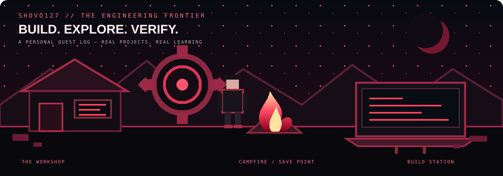

 

**CAMPFIRE MENU / CHOOSE YOUR ROUTE**

- 🗺️ **Start a quest:** jump to the [project board](#quest-board).
- 🌳 **Study the skill tree:** explore the [engineering paths](#skill-tree).
- 🎒 **Check the inventory:** open the [workshop inventory](#loot-room).
- ⚙️ **Enter the arena:** read the [engineering challenge](#boss-arena).
- 📚 **Visit the training ground:** see [education and practice](#training-ground).
- 💾 **Save your progress:** [connect](#save-point).

## PLAYER PROFILE / FIELD NOTES

**PLAYER:** Mohammed Thuhidul Islam Shovo  
**CLASS:** Automobile Engineering · Software Builder  
**HOME BASE:** Dhaka, Bangladesh  
**CURRENT MAIN QUEST:** Building practical technology and improving systems through careful investigation, implementation and verification.

Diploma graduate in **Automobile Engineering** from Dhaka Polytechnic Institute. My projects explore browser automation, multi-provider AI, Android diagnostics, desktop architecture and learning technology. I approach each build by understanding the system, defining its boundaries and checking what actually works.

The RPG presentation is a creative interface for real projects and learning. It does not represent a game account, fictional XP, rankings or invented achievements.

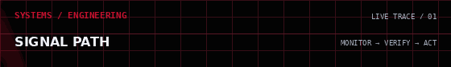

## 🗺️ QUEST BOARD / SELECT A PROJECT

Six real repositories. Choose a quest to inspect its source, implementation and current scope. The animated artwork is an original visual interpretation of documented workflows—not a screenshot of a live application.

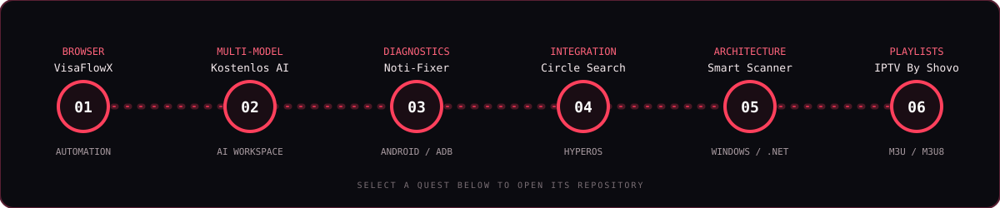

<table>
  <tr>
    <td width="50%" valign="top">
      <a href="https://github.com/shovo127/visaflowx-universal">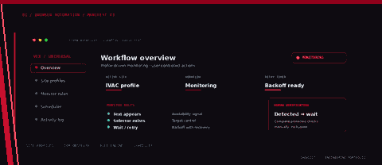</a>
      
<strong>QUEST 01 / BROWSER AUTOMATION · MANIFEST V3</strong>

      <h3><a href="https://github.com/shovo127/visaflowx-universal">VisaFlowX Universal</a></h3>
      
Profile-driven browser workflow assistant with DOM monitoring, configurable rules, retries, scheduling and notifications. Protected verification is handed back to the user; no CAPTCHA or anti-bot bypass.

      
<strong>TOOLS</strong> · JavaScript · Chrome Extension APIs · MutationObserver

      
<a href="https://github.com/shovo127/visaflowx-universal">OPEN QUEST ↗</a>

    </td>
    <td width="50%" valign="top">
      <a href="https://github.com/shovo127/kostenlos-ai">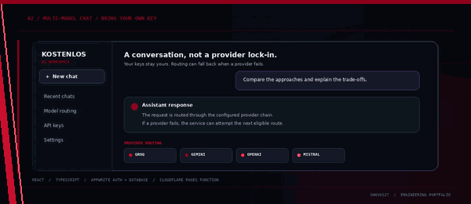</a>
      
<strong>QUEST 02 / MULTI-PROVIDER AI</strong>

      <h3><a href="https://github.com/shovo127/kostenlos-ai">Kostenlos AI</a></h3>
      
Bring-your-own-key AI chat application. Appwrite stores user-managed provider keys; the chat function supports failover across Groq, Gemini, OpenAI and Mistral, with optional Tavily search context.

      
<strong>TOOLS</strong> · React · TypeScript · Appwrite · Cloudflare Pages Functions

      
<a href="https://github.com/shovo127/kostenlos-ai">OPEN QUEST ↗</a>

    </td>
  </tr>
  <tr>
    <td width="50%" valign="top">
      <a href="https://github.com/shovo127/Noti-Fixer-for-Chinese-Devices">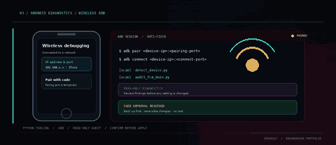</a>
      
<strong>QUEST 03 / ANDROID DIAGNOSTICS</strong>

      <h3><a href="https://github.com/shovo127/Noti-Fixer-for-Chinese-Devices">Noti-Fixer for Chinese Devices</a></h3>
      
Python and ADB toolkit for wireless pairing, notification/background diagnostics and reversible settings on selected Android ROMs. Findings are reviewed and changes require user approval.

      
<strong>TOOLS</strong> · Python · ADB · Shell / PowerShell · Android

      
<a href="https://github.com/shovo127/Noti-Fixer-for-Chinese-Devices">OPEN QUEST ↗</a>

    </td>
    <td width="50%" valign="top">
      <a href="https://github.com/shovo127/Circle-to-Search-for-Xiaomi">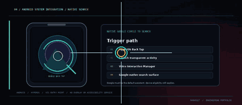</a>
      
<strong>QUEST 04 / ANDROID INTEGRATION</strong>

      <h3><a href="https://github.com/shovo127/Circle-to-Search-for-Xiaomi">Circle to Search for Xiaomi</a></h3>
      
Minimal Android trigger for Google's native Circle to Search on supported Xiaomi/HyperOS configurations. A transparent activity invokes Android's Voice Interaction Manager. Google default-assistant and device-eligibility requirements apply.

      
<strong>TOOLS</strong> · Kotlin · Android SDK · HyperOS Back Tap · Voice Interaction Manager

      
<a href="https://github.com/shovo127/Circle-to-Search-for-Xiaomi">OPEN QUEST ↗</a>

    </td>
  </tr>
  <tr>
    <td width="50%" valign="top">
      <a href="https://github.com/shovo127/Smart-Scanner-Pro">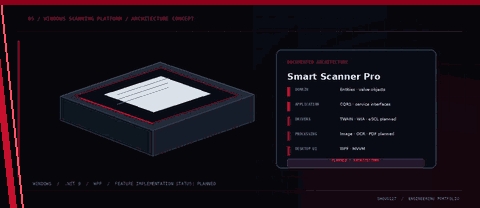</a>
      
<strong>QUEST 05 / WINDOWS ARCHITECTURE</strong>

      <h3><a href="https://github.com/shovo127/Smart-Scanner-Pro">Smart Scanner Pro</a></h3>
      
Windows scanning architecture organised around C#/.NET and Clean Architecture boundaries. TWAIN/WIA/eSCL integration, OCR, image processing, PDF workflows and plugins are treated as planned scope unless implemented in the repository.

      
<strong>TOOLS</strong> · C# · .NET · WPF · Clean Architecture

      
<a href="https://github.com/shovo127/Smart-Scanner-Pro">OPEN QUEST ↗</a>

    </td>
    <td width="50%" valign="top">
      <a href="https://github.com/shovo127/IPTV-By-Shovo">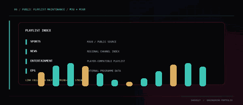</a>
      
<strong>QUEST 06 / OPEN PLAYLIST MAINTENANCE</strong>

      <h3><a href="https://github.com/shovo127/IPTV-By-Shovo">IPTV By Shovo</a></h3>
      
Public collection of third-party channel links and M3U/M3U8 playlists for compatible media players. No video streams are hosted by this repository; source availability and rights remain with original providers.

      
<strong>FORMAT</strong> · M3U · M3U8 · Playlist data

      
<a href="https://github.com/shovo127/IPTV-By-Shovo">OPEN QUEST ↗</a>

    </td>
  </tr>
</table>

## 🌳 SKILL TREE / ENGINEERING PATHS

These are the areas explored through study and projects—not a claim of expert-level mastery in every branch.

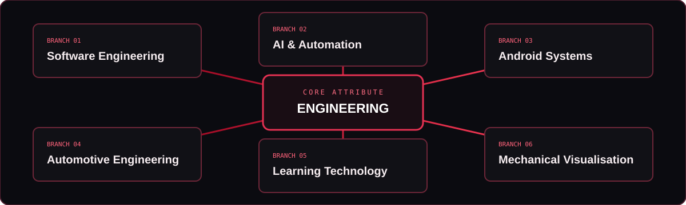

<table>
  <tr>
    <td width="50%" valign="top">
      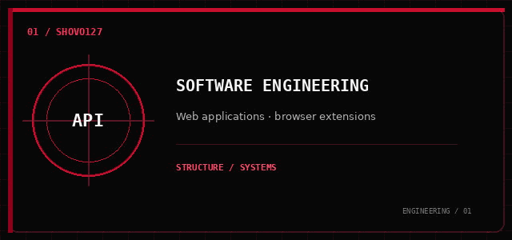
      <h3>01 — Software Engineering</h3>
      
Web applications, browser extensions, structured interfaces and practical architecture.

    </td>
    <td width="50%" valign="top">
      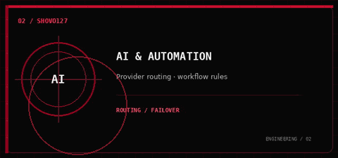
      <h3>02 — AI &amp; Automation</h3>
      
Multi-provider integrations, routing, retries and user-controlled workflows.

    </td>
  </tr>
  <tr>
    <td width="50%" valign="top">
      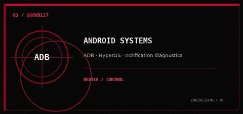
      <h3>03 — Android Systems</h3>
      
ADB workflows, HyperOS behaviour, notification diagnostics and native integrations.

    </td>
    <td width="50%" valign="top">
      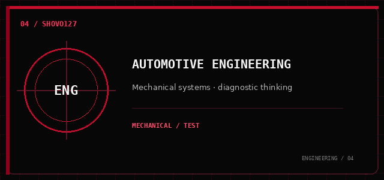
      <h3>04 — Automotive Engineering</h3>
      
Mechanical assemblies, automotive systems and diagnostic thinking grounded in diploma study.

    </td>
  </tr>
  <tr>
    <td width="50%" valign="top">
      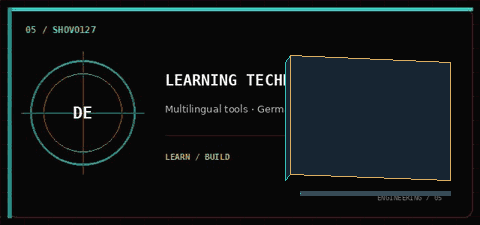
      <h3>05 — Learning Technology</h3>
      
Multilingual learning experiences and German study resources, including current TELC B2 preparation.

    </td>
    <td width="50%" valign="top">
      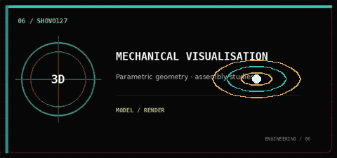
      <h3>06 — Mechanical Visualisation</h3>
      
Parametric geometry, assembly studies and technical visualisation alongside software work.

    </td>
  </tr>
</table>

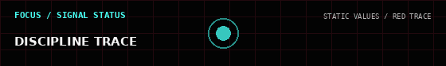

## 🎒 LOOT ROOM / WORKSHOP INVENTORY

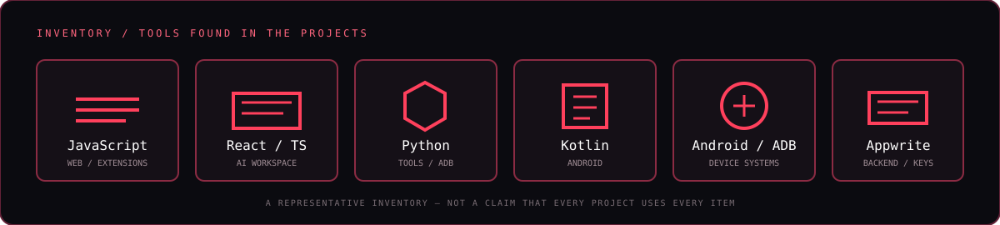

<strong>Open the inventory — additional tools and platforms</strong>

- **Web &amp; browser:** JavaScript, Chrome Extension APIs, React, TypeScript.
- **AI &amp; backend:** Appwrite, Cloudflare Pages Functions, Groq, Gemini, OpenAI, Mistral and optional Tavily search context.
- **Android &amp; diagnostics:** Kotlin, Android SDK, ADB, Python, Shell and PowerShell.
- **Desktop architecture study:** C#, .NET and WPF are listed for Smart Scanner Pro; integrations and features remain planned unless implemented in its repository.
- **Playlist formats:** M3U and M3U8.

## ⚙️ BOSS ARENA / THE REAL CHALLENGE

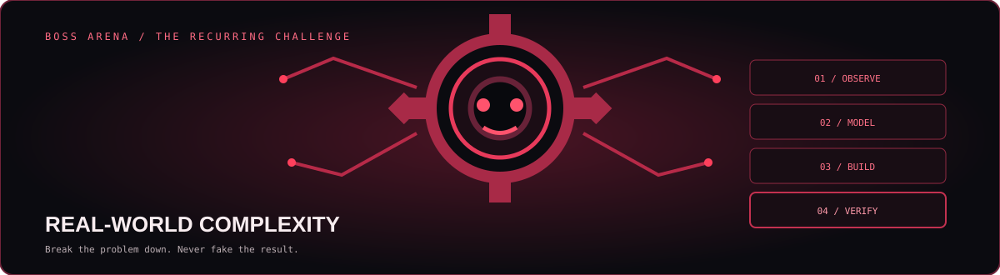

 

**BOSS MECHANIC / DEFEAT COMPLEXITY WITH A PROCESS**

1. **Observe** — understand the actual requirement and user behaviour.
2. **Model** — map architecture, dependencies and failure boundaries.
3. **Build** — implement a focused, maintainable solution.
4. **Verify** — test the behaviour and check for regressions.

Complex problems rarely yield to flashy claims. The goal is useful software—not a decorative demo that pretends to be production-ready.

## 📚 TRAINING GROUND / EDUCATION &amp; PRACTICE

<table>
  <tr>
    <td width="50%" valign="top">
      
<strong>COMPLETED STUDY</strong>

      <h3>Diploma in Automobile Engineering</h3>
      
<strong>Dhaka Polytechnic Institute</strong>

      
Technical education in automobile engineering.

    </td>
    <td width="50%" valign="top">
      
<strong>CURRENT LEARNING QUEST</strong>

      <h3>TELC Deutsch B2</h3>
      
<strong>German language preparation</strong>

      
Currently preparing for the TELC B2 examination.

    </td>
  </tr>
</table>

### Mechanical workshop / 3D study

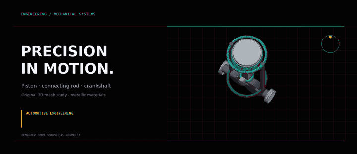

Original parametric mesh study rendered from generated geometry; not a production engine model. The available source is a rendered study, not an editable CAD assembly.

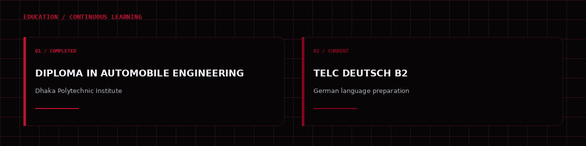

## 📊 FIELD RECORD / PUBLIC REPOSITORY SNAPSHOT

<strong>GITHUB PUBLIC DATA / SNAPSHOT 2026-11-07</strong>

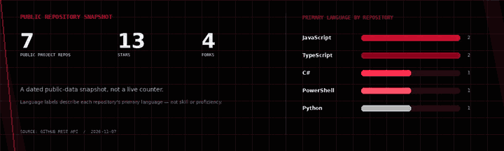

Seven public project repositories · 13 stars · 4 forks. Language counts represent each repository's primary language, not code-byte share or personal proficiency. The snapshot excludes this profile repository and private repositories. Values are static, not live.

## 🏅 PROGRESS LOG / VERIFIED MILESTONES

<strong>Open the progress log</strong>

- **Completed:** Diploma in Automobile Engineering — Dhaka Polytechnic Institute.
- **In progress:** TELC Deutsch B2 preparation.
- **Ongoing practice:** browser automation, AI integrations, Android diagnostics, software architecture and mechanical visualisation through the repositories linked above.

## ❔ FIELD GUIDE / FAQ

<strong>Are the project animations screenshots of working applications?</strong>

No. They are original visual interpretations of repository workflows. Open each linked repository for source code, implementation details and current status.

<strong>Are all features shown in Smart Scanner Pro already implemented?</strong>

No. The README explicitly distinguishes planned scanning integrations and workflows from features implemented in the repository.

<strong>Does the IPTV repository host video streams?</strong>

No. It maintains third-party playlist links and M3U/M3U8 data. It does not host video streams.

<strong>What is the best way to explore the work?</strong>

Start with the quest board, open a repository, and check its README and source files for the current implementation.

## 💾 SAVE POINT / CONNECT

<table>
  <tr>
    <td width="33%" valign="top" align="center">
      
<strong>CODE / REPOSITORIES</strong>

      <h3><a href="https://github.com/shovo127">GitHub</a></h3>
      
<a href="https://github.com/shovo127">github.com/shovo127</a>

    </td>
    <td width="33%" valign="top" align="center">
      
<strong>LEARNING / EDUCATION</strong>

      <h3><a href="https://lernedeutschmittechnologie.tech">Learning Project</a></h3>
      
<a href="https://lernedeutschmittechnologie.tech">lernedeutschmittechnologie.tech</a>

    </td>
    <td width="33%" valign="top" align="center">
      
<strong>DIRECT CONTACT</strong>

      <h3><a href="mailto:contact@lernedeutschmittechnologie.tech">Email</a></h3>
      
<a href="mailto:contact@lernedeutschmittechnologie.tech">contact@lernedeutschmittechnologie.tech</a>

    </td>
  </tr>
</table>

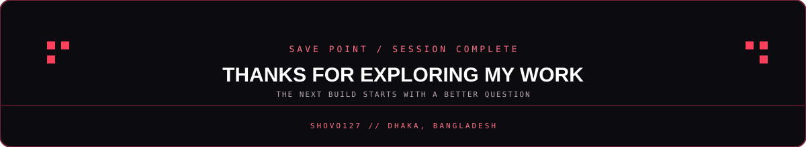

All game-inspired artwork is original portfolio artwork. Project descriptions link to their repositories for implementation details and current status.
