

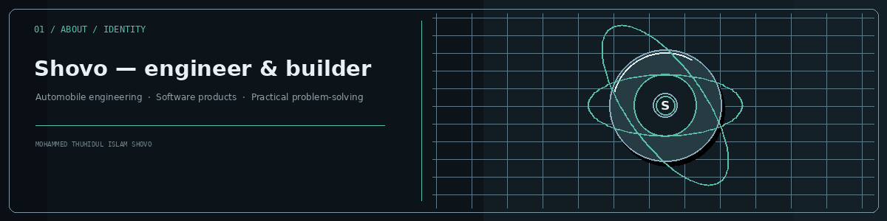

### Mohammed Thuhidul Islam Shovo

**Automobile Engineering Graduate · Independent Software Builder · Technology Enthusiast**

I build practical digital products across AI applications, browser automation, Android utilities and web technology. My approach is simple: understand a real problem, design a useful solution, and improve it through careful engineering.

[Projects](https://github.com/shovo127?tab=repositories) · [Lerne Deutsch Mit Technologie](https://lernedeutschmittechnologie.tech) · [MailMerge by Shovo](https://mailmergebyshovo.qzz.io/) · [GitHub](https://github.com/shovo127)

---

## 01 / About Me

I’m a technology-focused engineer from **Dhaka, Bangladesh**, with a Diploma in Automobile Engineering. My interests sit at the intersection of engineering, software, automation and accessible digital learning.

- **Education:** Diploma in Engineering — Automobile, Dhaka Polytechnic Institute
- **Current learning:** German language; preparing for TELC Deutsch B2
- **Building:** AI-powered tools, browser automation and practical web applications
- **Exploring:** Android systems, HyperOS utilities, PC hardware and developer tooling
- **Working principle:** build useful things, verify them carefully and improve them with evidence

## 02 / Engineering Focus

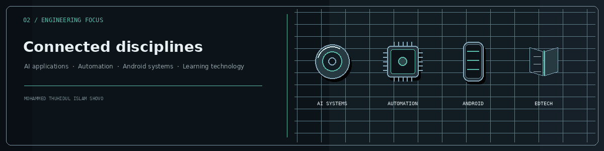

| Discipline | Areas of interest | Selected work |
|---|---|---|
| **AI Applications** | Multi-provider AI experiences, API integrations and practical AI workflows | [Kostenlos AI](https://github.com/shovo127/kostenlos-ai) |
| **Automation Engineering** | Browser extensions, configurable workflows, scheduling, monitoring and recovery | [VisaFlowX](https://github.com/shovo127/visaflowx) · [Universal](https://github.com/shovo127/visaflowx-universal) |
| **Android & Device Utilities** | Android tooling, HyperOS utilities, diagnostics and notification reliability | [Noti-Fixer](https://github.com/shovo127/Noti-Fixer-for-Chinese-Devices) |
| **Web & Learning Technology** | Multilingual experiences, interactive practice and digital learning tools | [Lerne Deutsch Mit Technologie](https://lernedeutschmittechnologie.tech) |

## 03 / Featured Work

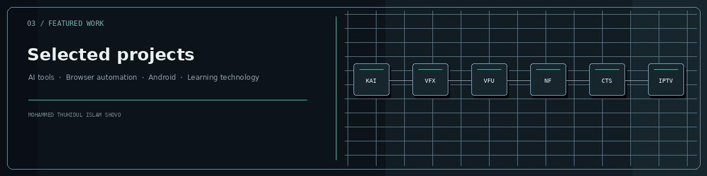

| Project | Purpose |
|---|---|
| [Kostenlos AI](https://github.com/shovo127/kostenlos-ai) | Multi-provider AI chat experience |
| [VisaFlowX](https://github.com/shovo127/visaflowx) | Browser workflow assistant for IVAC processes |
| [VisaFlowX Universal](https://github.com/shovo127/visaflowx-universal) | Configurable browser automation |
| [Noti-Fixer](https://github.com/shovo127/Noti-Fixer-for-Chinese-Devices) | Android notification diagnostics and device troubleshooting |
| [Circle to Search for Xiaomi](https://github.com/shovo127/Circle-to-Search-for-Xiaomi) | Xiaomi-focused Android assistant shortcut |
| [IPTV By Shovo](https://github.com/shovo127/IPTV-By-Shovo) | M3U playlist and media utility project |

### More work

- [Lerne Deutsch Mit Technologie](https://lernedeutschmittechnologie.tech) — German-learning platform and exam preparation.
- [MailMerge by Shovo](https://mailmergebyshovo.qzz.io/) — email productivity and automation.
- [Smart Scanner Pro](https://github.com/shovo127/Smart-Scanner-Pro) — utility application.
- [All public repositories](https://github.com/shovo127?tab=repositories) — explore the complete project list.

## 04 / Technology & Tools

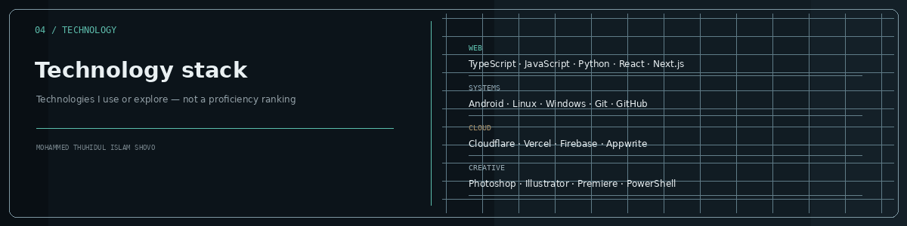

| Area | Technologies and tools |
|---|---|
| **Web & Programming** | HTML, CSS, JavaScript, TypeScript, Python, React, Next.js, Node.js, Tailwind CSS |
| **Platforms** | Android, Linux, Windows |
| **Infrastructure & Developer Tools** | Git, GitHub, Cloudflare, Vercel, Appwrite, Firebase, PowerShell |
| **Creative & Productivity** | Photoshop, Illustrator, Premiere Pro, VS Code |

These represent technologies I work with or explore. They are not proficiency ratings or claims of equal expertise.

## 05 / GitHub Command Center

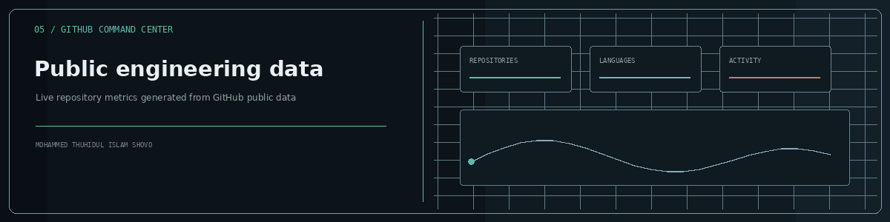

Generated from GitHub's public API and committed to this repository. Language shares represent code volume, not skill level. Dashboard refreshes automatically.

[Dashboard workflow](https://github.com/shovo127/shovo127/actions/workflows/profile-dashboard.yml) · [Public repositories](https://github.com/shovo127?tab=repositories)

## 06 / Achievements & Milestones

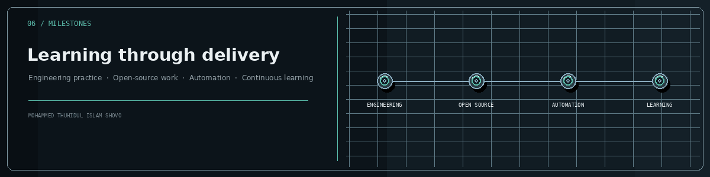

I value demonstrable work and continuous learning over decorative achievement counts. The original repository-hosted achievement illustration is retained: [View the achievement artwork](./assets/profile-trophies.svg).

## 07 / Your Contribution City

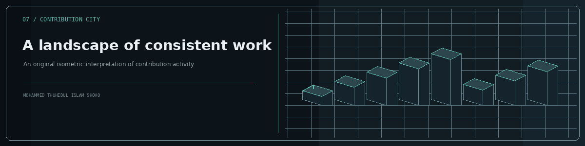

An original visual metaphor for steady development and learning. The earlier contribution-city illustration remains available: [View the original contribution city](./assets/contribution-city.svg).

## 08 / Contribution Snake

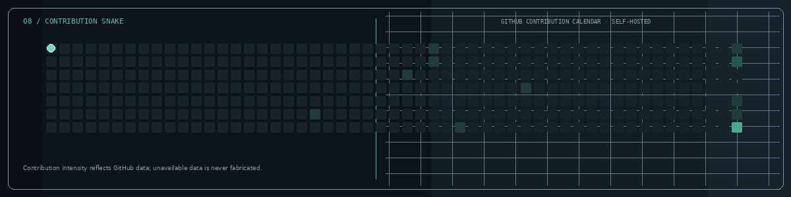

The snake animation is generated locally and stored in this repository. Contribution intensity comes from GitHub's public contribution calendar; when the data source is unavailable, the grid stays neutral rather than inventing activity. The earlier snake illustration is preserved: [View the original snake artwork](./assets/contribution-snake.svg).

## 09 / Coding Habits

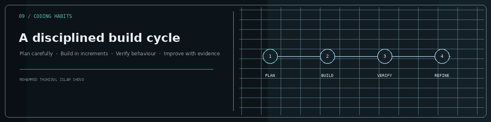

I prefer a repeatable process: understand the requirement, build in small increments, test edge cases and refine based on evidence. Optional WakaTime reporting is not enabled, so no coding-hour totals are displayed or fabricated.

## 10 / Recent Writing

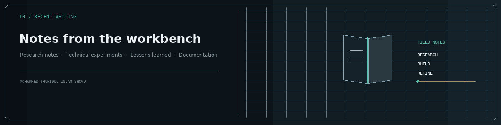

<!-- BLOG-POST-LIST:START -->
*Blog feed will appear here after a public RSS or Atom feed is configured.*
<!-- BLOG-POST-LIST:END -->

## 11 / Beyond Code

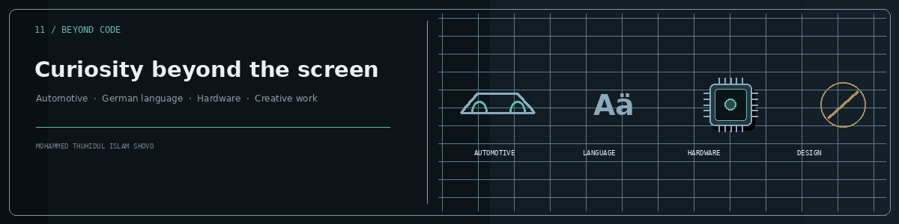

- **Automotive engineering:** the connection between mechanical systems, electronics and software.
- **Language learning:** German and tools that make structured learning more accessible.
- **Technology exploration:** AI products, Android customization, PC hardware and practical automation.
- **Creative work:** visual communication and thoughtful product presentation.

## 12 / Let's Connect

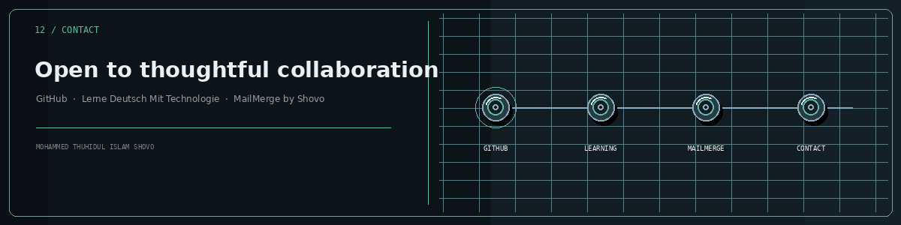

[GitHub · @shovo127](https://github.com/shovo127) · [Discord profile](https://discord.com/users/838358451393396746) · [Discord community](https://discord.gg/kcAhn7n3kb)

[Lerne Deutsch Mit Technologie](https://lernedeutschmittechnologie.tech) · [MailMerge by Shovo](https://mailmergebyshovo.qzz.io/) · [Instagram](https://www.instagram.com/thuhidul_islamshovo/)

**Have an interesting technical idea or a useful project? Let's connect.**

---

*Build with curiosity. Engineer with care. Improve through iteration.*

Profile visuals are generated and stored in this repository · Dhaka, Bangladesh

Earlier artwork and animation iterations — retained in this repository

The previous visual assets were kept rather than deleted. They remain available as source artwork and archived iterations:

- Header and identity: [banner](./assets/banner.svg) · [profile badges](./assets/profile-badges.svg) · [About portrait](./assets/about-portrait.svg)
- Sections: [engineering focus](./assets/engineering-focus.svg) · [technology stack SVG](./assets/technology-stack.svg) · [technology stack PNG preview](./assets/technology-stack.png) · [achievement artwork](./assets/profile-trophies.svg) · [contribution city](./assets/contribution-city.svg) · [original contribution snake](./assets/contribution-snake.svg) · [coding rhythm](./assets/coding-rhythm.svg) · [learning loop](./assets/learning-loop.svg) · [footer](./assets/footer.svg)
- Project illustrations: [Kostenlos AI](./assets/projects/kostenlos-ai.svg) · [VisaFlowX](./assets/projects/visaflowx.svg) · [VisaFlowX Universal](./assets/projects/visaflowx-universal.svg) · [Noti-Fixer](./assets/projects/noti-fixer.svg) · [Circle to Search](./assets/projects/circle-search.svg) · [IPTV By Shovo](./assets/projects/iptv-shovo.svg)
- Earlier motion iterations: [About](./assets/about-motion.gif) · [Focus](./assets/focus-motion.gif) · [Projects](./assets/projects-motion.gif) · [Technology](./assets/technology-motion.gif) · [Dashboard](./assets/dashboard-motion.gif) · [Achievements](./assets/achievement-motion.gif) · [City](./assets/city-motion.gif) · [Coding habits](./assets/habits-motion.gif) · [Beyond code](./assets/beyond-code-motion.gif) · [Connect](./assets/connect-motion.gif) · [Earlier snake](./assets/contribution-snake.gif)

