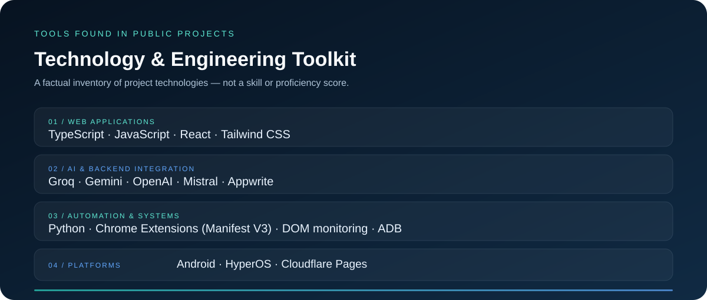
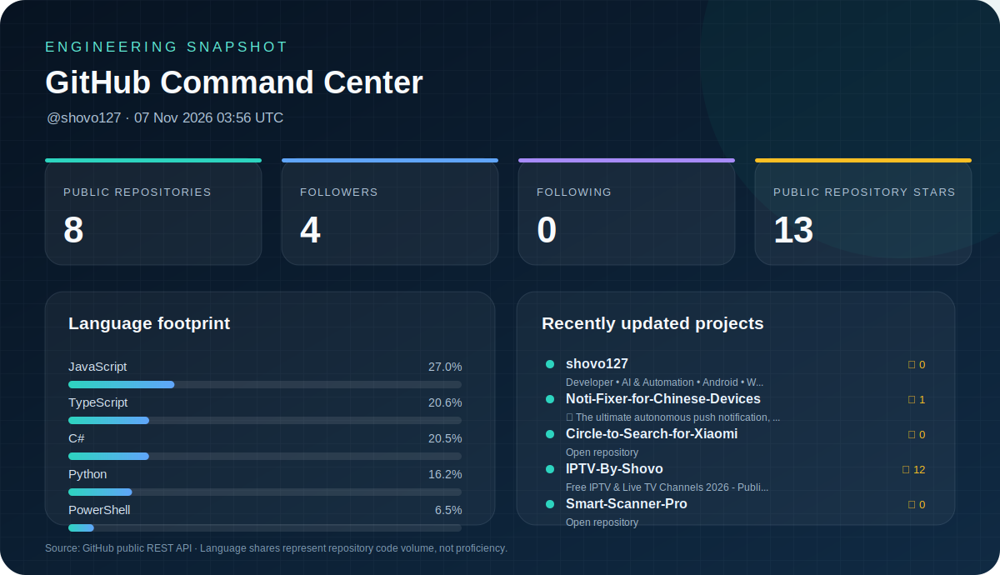
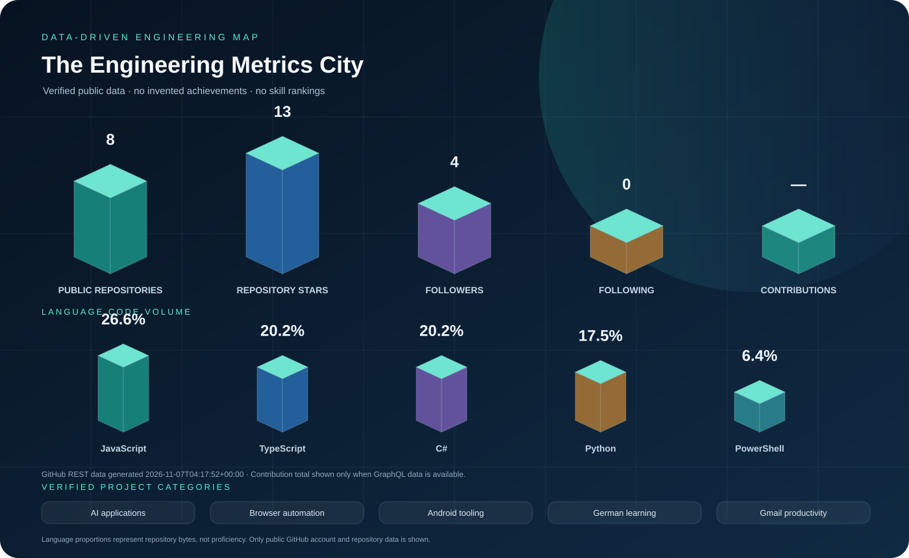
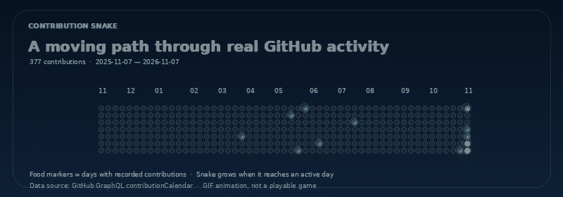

### Mohammed Thuhidul Islam Shovo
**Diploma in Automobile Engineering · Independent Software Builder · Technology Explorer**

*I turn curiosity into practical tools — combining engineering thinking with software, automation and AI.*

[Projects](https://github.com/shovo127?tab=repositories) · [Lerne Deutsch Mit Technologie](https://lernedeutschmittechnologie.tech) · [MailMerge by Shovo](https://mailmergebyshovo.qzz.io/) · [GitHub](https://github.com/shovo127)

---

## 01 / About Me

### Engineer by training. Builder by curiosity.

I’m based in **Dhaka, Bangladesh**, with a Diploma in Automobile Engineering from **Dhaka Polytechnic Institute**. My interests connect mechanical systems, software, digital products and practical problem-solving. I also build [Lerne Deutsch Mit Technologie](https://lernedeutschmittechnologie.tech), a free German-learning platform with interactive practice and TELC/Goethe preparation.

- 🎓 Diploma in Engineering — Automobile
- 🇩🇪 Learning German; preparing for TELC Deutsch B2
- 🧩 Building AI-powered tools and browser automation
- 📱 Exploring Android, HyperOS and device reliability
- 🌱 Learning by building, testing and improving

**My principle:** make technology useful, understandable and accessible.

## 02 / Engineering Focus

I work across connected disciplines rather than treating technology as isolated tools:

- **AI applications** — useful AI experiences, API integrations and multi-provider workflows.
- **Automation engineering** — browser workflows, scheduling, monitoring, retries and error recovery.
- **Android systems** — device tooling, HyperOS utilities, diagnostics and notification reliability.
- **Learning technology** — multilingual learning, interactive practice and exam preparation.

## 03 / Featured Work

### Selected public repositories

<table>
<tr>
<td width="50%">

<b>VisaFlowX Universal</b> Manifest V3 workflow assistant with site profiles, DOM monitoring, retries, schedules and notifications. Protected verification stays user-controlled.

</td>
<td width="50%">

<b>Kostenlos AI</b> Bring-your-own-key AI chat with Appwrite accounts and provider failover across Groq, Gemini, OpenAI and Mistral.

</td>
</tr>
<tr>
<td width="50%">

<b>Noti-Fixer</b> Android/ADB toolkit for notification reliability and reversible background-app configuration on Chinese ROMs. Check its repository licence before reuse.

</td>
<td width="50%">

<b>Circle to Search for Xiaomi</b> Native Android trigger for Google's Circle to Search on supported Xiaomi/HyperOS configurations.

</td>
</tr>
<tr>
<td width="50%">

<b>VisaFlowX</b> IVAC Bangladesh sign-in workflow helper with user-completed verification and OTP handoff.

</td>
<td width="50%">

<b>Other work</b> <a href="https://lernedeutschmittechnologie.tech">Lerne Deutsch Mit Technologie</a> — free German learning and TELC/Goethe preparation platform. <a href="https://mailmergebyshovo.qzz.io/">MailMerge by Shovo</a> — Gmail-native mail merge with CSV personalization, scheduling and campaign reporting. <a href="https://github.com/shovo127/IPTV-By-Shovo">IPTV By Shovo</a>

</td>
</tr>
</table>

[Browse all public repositories](https://github.com/shovo127?tab=repositories)

## 04 / Technology & Tools

These technologies appear in my public projects; this is not a proficiency ranking.

## 05 / GitHub Command Center

City structures represent verified counts; language districts represent code bytes, not proficiency. Contribution totals appear only when GitHub returns them.

Generated from GitHub's public API and committed to this repository. Language shares indicate code volume, not skill level. Dashboard refreshes automatically.

[Dashboard workflow](https://github.com/shovo127/shovo127/actions/workflows/profile-dashboard.yml) · [Raw dashboard data](./assets/github-dashboard-data.json) · [Public repositories](https://github.com/shovo127?tab=repositories)

## 06 / Precision Engineering

*A visual nod to measurement, tolerances and careful engineering.*

## 07 / Contribution City

The animated 3D city is a dated contribution snapshot. The static SVG and snake animation refresh daily from the latest calendar; unavailable data is shown neutrally. [Static SVG city](./assets/contribution-city-data.svg) · [3D city source snapshot](./assets/contribution-calendar.json) · [Live calendar](./assets/contribution-calendar.json)

## 08 / Contribution Snake

The snake follows a continuous, collision-free path across the dated contribution grid. Active contribution days are food markers; the snake grows as it reaches them. This is a generated GIF visualization, not a playable game.

[Preserved classic snake animation](./assets/section-08-contribution-snake.gif) · [Contribution data snapshot](./assets/contribution-calendar.json)

## 09 / Learning & Interests

I work iteratively: research a problem, build a small solution, test it, document what failed and improve it.

- **Automotive engineering:** mechanical systems, electronics, diagnostics and the connection between hardware and software.
- **German:** preparing for TELC Deutsch B2.
- **Technology exploration:** Android/HyperOS, PC hardware, AI applications and practical automation.

## 10 / Let's Connect

<a href="https://github.com/shovo127">GitHub · @shovo127</a> · <a href="https://discord.com/users/838358451393396746">Discord</a> · <a href="https://discord.gg/kcAhn7n3kb">Community</a>

<a href="https://lernedeutschmittechnologie.tech">Lerne Deutsch Mit Technologie</a> · <a href="https://mailmergebyshovo.qzz.io/">MailMerge by Shovo</a> · <a href="https://www.instagram.com/thuhidul_islamshovo/">Instagram</a>

**Have an interesting technical idea or a useful project? Let's connect.**

---

*Build with curiosity. Engineer with care. Improve through iteration.*

Blender-rendered 3D media · Self-hosted in this repository · Dhaka, Bangladesh

Previous artwork and animation assets — preserved

All previous artwork remains in the repository; the new 3D renders are additional assets, not destructive replacements.

- [Original banner](./assets/3d/00-hero.gif) · [Profile badges](./assets/profile-badges.svg) · [About portrait](./assets/about-portrait.svg)
- [Engineering focus](./assets/engineering-focus.svg) · [Technology stack](./assets/technology-stack.svg) · [Coding rhythm](./assets/coding-rhythm.svg) · [Learning loop](./assets/learning-loop.svg)
- [Legacy contribution-city concept — illustrative only](./assets/contribution-city.svg) · [Static snake concept — not the animated GIF](./assets/contribution-snake.svg) · [Decorative milestone graphic — not an award record](./assets/profile-trophies.svg)
- [About motion](./assets/about-motion.gif) · [Focus motion](./assets/focus-motion.gif) · [Projects motion](./assets/projects-motion.gif) · [Technology motion](./assets/technology-motion.gif) · [Dashboard motion](./assets/dashboard-motion.gif) · [Achievement motion](./assets/achievement-motion.gif) · [City motion](./assets/city-motion.gif) · [Coding habits motion](./assets/habits-motion.gif) · [Beyond code motion](./assets/beyond-code-motion.gif) · [Connect motion](./assets/connect-motion.gif)

