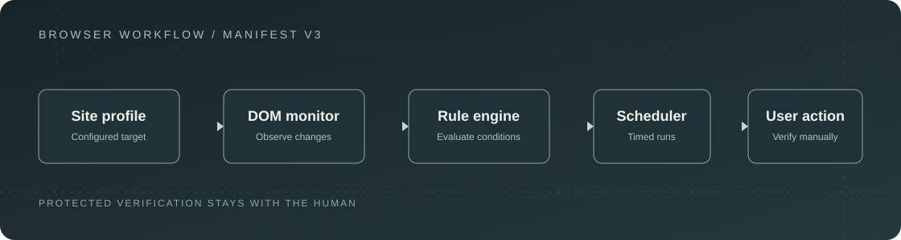
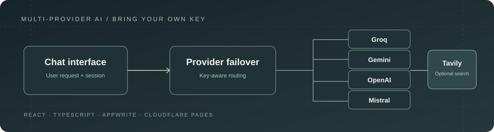
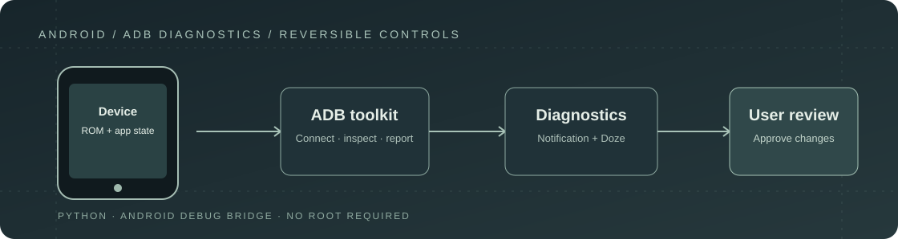
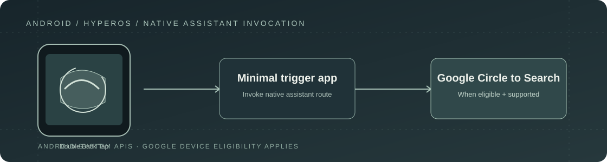

<h1 align="center">Mohammed Thuhidul Islam Shovo</h1>

<strong>Engineering Mindset · Software Building · AI & Automation · Practical Technology</strong>

Dhaka, Bangladesh · <a href="https://github.com/shovo127">GitHub</a> · <a href="https://lernedeutschmittechnologie.tech">Lerne Deutsch Mit Technologie</a>

---

## Profile

I am a Diploma in Automobile Engineering graduate from **Dhaka Polytechnic Institute**. I explore the connection between engineering systems and software by building practical tools, testing real workflows and documenting technical limits.

My current interests include software products, AI integrations, browser automation, Android systems, PC hardware and learning technology. I am also preparing for **TELC Deutsch B2**.

## Selected work

A selection of public projects spanning browser automation, AI applications and Android tooling.

<table>
  <tr>
    <td width="50%" valign="top">
      
      <h3><a href="https://github.com/shovo127/visaflowx-universal">VisaFlowX Universal</a></h3>
      
A Manifest V3 browser workflow assistant with site profiles, DOM monitoring, configurable rules, retries, scheduling and notifications. Protected verification remains a manual user action.

      
<strong>Stack</strong> · JavaScript · Chrome Extensions · Manifest V3

      
<a href="https://github.com/shovo127/visaflowx-universal">Repository ↗</a>

    </td>
    <td width="50%" valign="top">
      
      <h3><a href="https://github.com/shovo127/kostenlos-ai">Kostenlos AI</a></h3>
      
A bring-your-own-key chat application with Appwrite authentication and provider failover across Groq, Gemini, OpenAI and Mistral. Tavily can add web-search context.

      
<strong>Stack</strong> · React · TypeScript · Tailwind CSS · Appwrite · Cloudflare Pages

      
<a href="https://github.com/shovo127/kostenlos-ai">Repository ↗</a>

    </td>
  </tr>
  <tr>
    <td width="50%" valign="top">
      
      <h3><a href="https://github.com/shovo127/Noti-Fixer-for-Chinese-Devices">Noti-Fixer for Chinese Devices</a></h3>
      
A Python and ADB toolkit for inspecting notification delivery and managing reversible background-app settings on selected Android ROMs. Device behaviour depends on firmware and user approval.

      
<strong>Stack</strong> · Python · Android Debug Bridge · Android

      
<a href="https://github.com/shovo127/Noti-Fixer-for-Chinese-Devices">Repository ↗</a>

    </td>
    <td width="50%" valign="top">
      
      <h3><a href="https://github.com/shovo127/Circle-to-Search-for-Xiaomi">Circle to Search for Xiaomi</a></h3>
      
A minimal native Android trigger designed to invoke Google's Circle to Search on supported Xiaomi and HyperOS configurations. Availability depends on Google's device eligibility and firmware options.

      
<strong>Stack</strong> · Android · Android system APIs

      
<a href="https://github.com/shovo127/Circle-to-Search-for-Xiaomi">Repository ↗</a>

    </td>
  </tr>
</table>

<a href="https://github.com/shovo127?tab=repositories">Browse all public repositories ↗</a>

## Technical focus

| Area | Current work |
|---|---|
| **Software engineering** | Web applications, browser extensions and practical utilities |
| **AI & automation** | Provider integrations, workflow rules, scheduling and recovery |
| **Android systems** | ADB tooling, HyperOS behaviour and device-level troubleshooting |
| **Automotive engineering** | Mechanical systems, diagnostics and hardware–software connections |
| **Learning technology** | Multilingual learning experiences and German exam preparation |

Technologies are listed where they are documented in the featured projects. They indicate project usage, not a proficiency ranking.

---

## Education

**Diploma in Automobile Engineering**  
Dhaka Polytechnic Institute

**Current learning**  
TELC Deutsch B2 preparation

---

## Connect

- **GitHub** · [@shovo127](https://github.com/shovo127)
- **Learning project** · [Lerne Deutsch Mit Technologie](https://lernedeutschmittechnologie.tech)

---

Build with curiosity. Engineer with care. Improve through iteration.

Independent engineering · Dhaka, Bangladesh

