

<h1 align="center">Mohammed Thuhidul Islam Shovo</h1>

<strong>Engineering Mindset · Software Building · AI & Automation · Practical Technology</strong>

Dhaka, Bangladesh · <a href="https://github.com/shovo127">GitHub</a> · <a href="https://lernedeutschmittechnologie.tech">Lerne Deutsch Mit Technologie</a>

---

  <a href="#quest-world">WORLD MAP</a> ·
  <a href="#mission-select">MISSIONS</a> ·
  <a href="#skill-tree">SKILL TREE</a> ·
  <a href="#loadout">LOADOUT</a> ·
  <a href="#boss-fight">BOSS FIGHT</a> ·
  <a href="#garage">GARAGE</a> ·
  <a href="#save-point">SAVE POINT</a>

<a href="https://shovo127.github.io/shovo127/"><strong>▶ PLAY THE RPG — ENTER THE SYSTEMS FRONTIER</strong></a>

## PLAYER PROFILE / BUILD PHILOSOPHY

I am an Automobile Engineering diploma graduate who builds practical software and studies how complex systems work—from browser workflows and AI applications to Android behaviour and mechanical assemblies.

**My build loop:** understand the constraints → model the system → implement carefully → verify the result.

The missions below link to real source repositories. Portfolio artwork is illustrative; the linked code is the source of truth for implementation and project status. The playable RPG is hosted separately so its movement, quests and save system work normally.

---

## 01 / QUEST WORLD

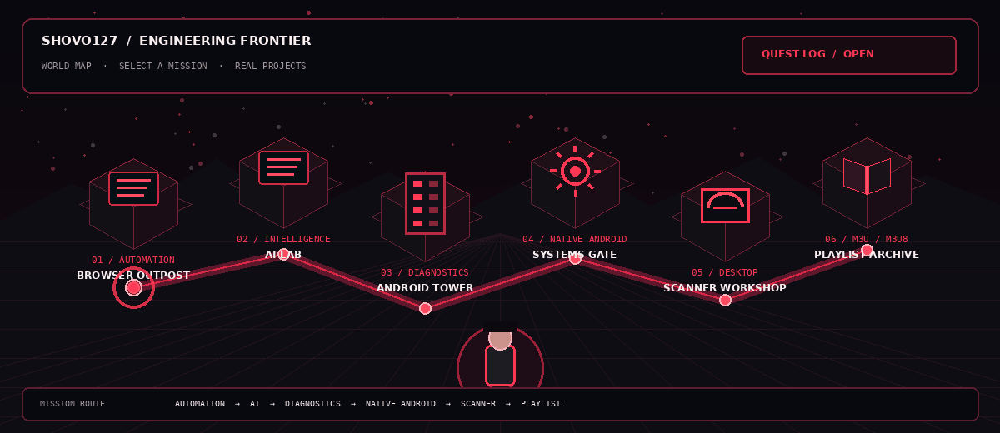

<strong>CHOOSE A REGION. ENTER A MISSION. EXPLORE THE REAL BUILD.</strong>

This is my engineering world: real repositories, real learning and practical experiments. The map is a visual guide; every mission below opens its source repository.

  <a href="#mission-01">[01] BROWSER OUTPOST</a> ·
  <a href="#mission-02">[02] AI LAB</a> ·
  <a href="#mission-03">[03] ANDROID TOWER</a> 
  <a href="#mission-04">[04] SYSTEMS GATE</a> ·
  <a href="#mission-05">[05] SCANNER WORKSHOP</a> ·
  <a href="#mission-06">[06] PLAYLIST ARCHIVE</a>

## 02 / MISSION SELECT

Six projects. Each card is a mission briefing; open the repository to inspect implementation, current status and source code. Motion artwork is illustrative, not a live application screenshot.

<table>
  <tr>
    <td width="50%" valign="top">
      
      <a href="https://github.com/shovo127/visaflowx-universal">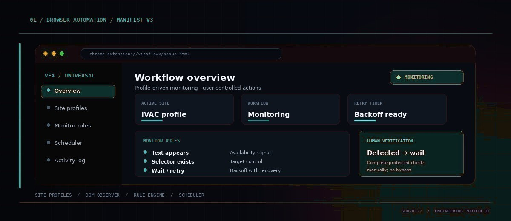</a>
      
<strong>MISSION 01 / BROWSER OUTPOST</strong>

      <h3><a href="https://github.com/shovo127/visaflowx-universal">VisaFlowX Universal</a></h3>
      
Profile-driven Manifest V3 browser workflow assistant with DOM monitoring, configurable rules, retries, scheduling and notifications. Protected verification remains user-controlled; no CAPTCHA or anti-bot bypass.

      
JAVASCRIPT · CHROME EXTENSION APIs · MUTATIONOBSERVER

      
<a href="https://github.com/shovo127/visaflowx-universal">ENTER MISSION ↗</a>

    </td>
    <td width="50%" valign="top">
      
      <a href="https://github.com/shovo127/kostenlos-ai">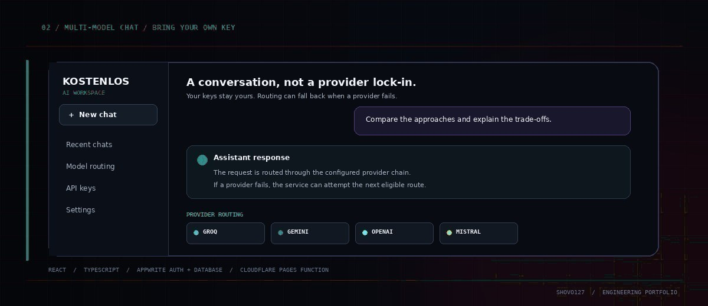</a>
      
<strong>MISSION 02 / AI LAB</strong>

      <h3><a href="https://github.com/shovo127/kostenlos-ai">Kostenlos AI</a></h3>
      
Bring-your-own-key AI chat application. Appwrite stores user-managed provider keys; the chat function supports failover across Groq, Gemini, OpenAI and Mistral, with optional Tavily search context.

      
REACT · TYPESCRIPT · APPWRITE · CLOUDFLARE PAGES FUNCTIONS

      
<a href="https://github.com/shovo127/kostenlos-ai">ENTER MISSION ↗</a>

    </td>
  </tr>
  <tr>
    <td width="50%" valign="top">
      
      <a href="https://github.com/shovo127/Noti-Fixer-for-Chinese-Devices">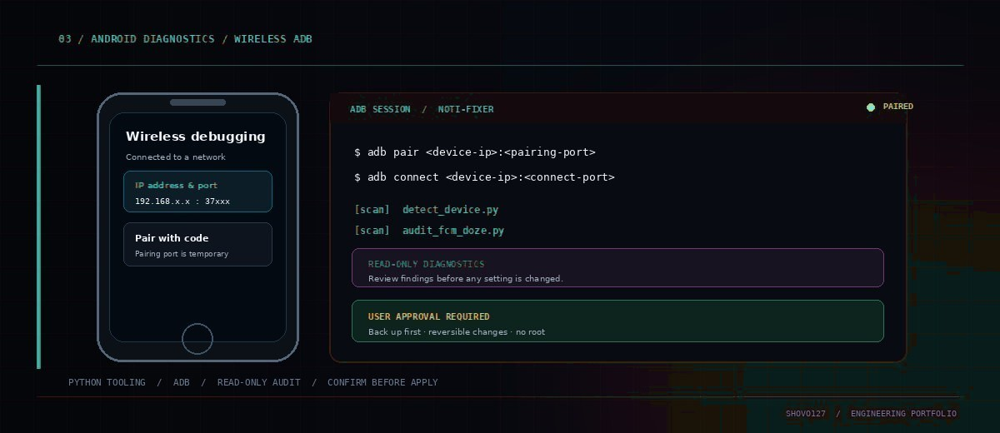</a>
      
<strong>MISSION 03 / ANDROID TOWER</strong>

      <h3><a href="https://github.com/shovo127/Noti-Fixer-for-Chinese-Devices">Noti-Fixer for Chinese Devices</a></h3>
      
Python and ADB toolkit for wireless pairing, notification/background diagnostics and reversible settings on selected Android ROMs. Findings are reviewed and changes require user approval.

      
PYTHON · ADB · SHELL / POWERSHELL · ANDROID

      
<a href="https://github.com/shovo127/Noti-Fixer-for-Chinese-Devices">ENTER MISSION ↗</a>

    </td>
    <td width="50%" valign="top">
      
      <a href="https://github.com/shovo127/Circle-to-Search-for-Xiaomi">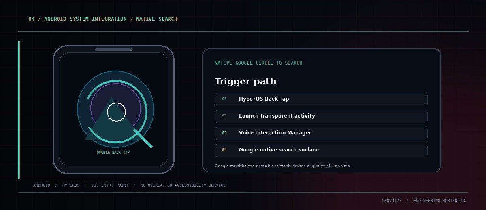</a>
      
<strong>MISSION 04 / SYSTEMS GATE</strong>

      <h3><a href="https://github.com/shovo127/Circle-to-Search-for-Xiaomi">Circle to Search for Xiaomi</a></h3>
      
Minimal Android trigger for Google's native Circle to Search on supported Xiaomi/HyperOS configurations. A transparent activity invokes Android's Voice Interaction Manager. Google default-assistant and device-eligibility requirements apply.

      
KOTLIN · ANDROID SDK · HYPEROS BACK TAP · VOICE INTERACTION MANAGER

      
<a href="https://github.com/shovo127/Circle-to-Search-for-Xiaomi">ENTER MISSION ↗</a>

    </td>
  </tr>
  <tr>
    <td width="50%" valign="top">
      
      <a href="https://github.com/shovo127/Smart-Scanner-Pro">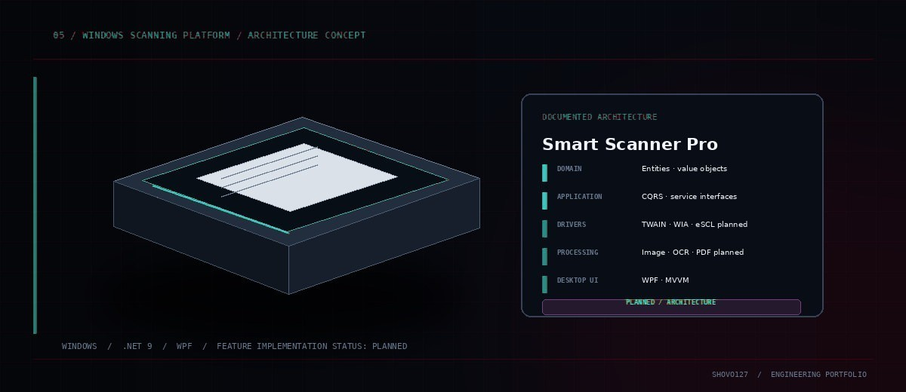</a>
      
<strong>MISSION 05 / SCANNER WORKSHOP</strong>

      <h3><a href="https://github.com/shovo127/Smart-Scanner-Pro">Smart Scanner Pro</a></h3>
      
Windows scanning architecture organised around C#/.NET and Clean Architecture boundaries. TWAIN/WIA/eSCL integration, OCR, image processing, PDF workflows and plugins are planned scope unless implemented in the repository.

      
C# · .NET · WPF · CLEAN ARCHITECTURE

      
<a href="https://github.com/shovo127/Smart-Scanner-Pro">ENTER MISSION ↗</a>

    </td>
    <td width="50%" valign="top">
      
      <a href="https://github.com/shovo127/IPTV-By-Shovo">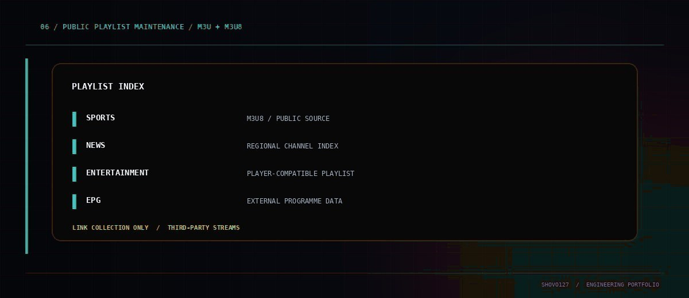</a>
      
<strong>MISSION 06 / PLAYLIST ARCHIVE</strong>

      <h3><a href="https://github.com/shovo127/IPTV-By-Shovo">IPTV By Shovo</a></h3>
      
Public collection of third-party channel links and M3U/M3U8 playlists for compatible media players. This repository does not host video streams; source availability and rights remain with original providers.

      
M3U · M3U8 · PLAYLIST DATA

      
<a href="https://github.com/shovo127/IPTV-By-Shovo">ENTER MISSION ↗</a>

    </td>
  </tr>
</table>

## 03 / SKILL TREE

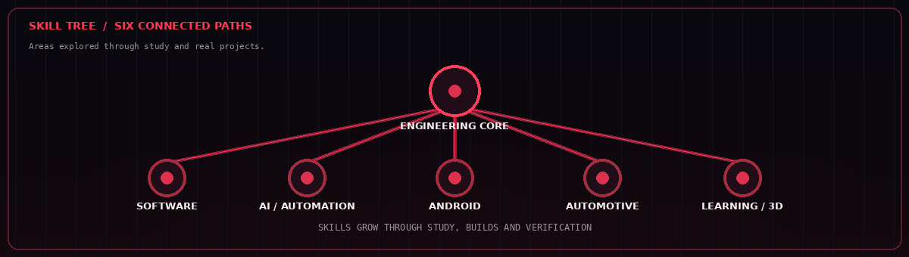

These are fields I explore through diploma study, projects and ongoing practice—not claims of mastery in every branch.

- **Software engineering:** browser extensions, web applications and maintainable architecture.
- **AI & automation:** multi-provider integrations, routing, retries and user-controlled workflows.
- **Android systems:** ADB, HyperOS behaviour, notification diagnostics and native integrations.
- **Automotive engineering:** mechanical assemblies, automotive systems and diagnostic thinking.
- **Learning technology:** multilingual learning experiences and German study resources.
- **Mechanical visualisation:** parametric geometry, assembly studies and technical visualisation.

## 04 / WORKSHOP LOADOUT

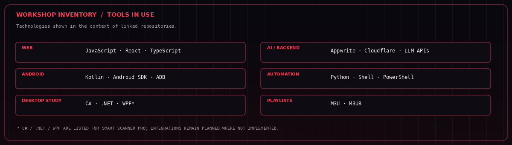

C#/.NET/WPF are associated with Smart Scanner Pro's architecture; integrations remain planned where they are not implemented.

## 05 / BOSS FIGHT — DEBUG THE SYSTEM

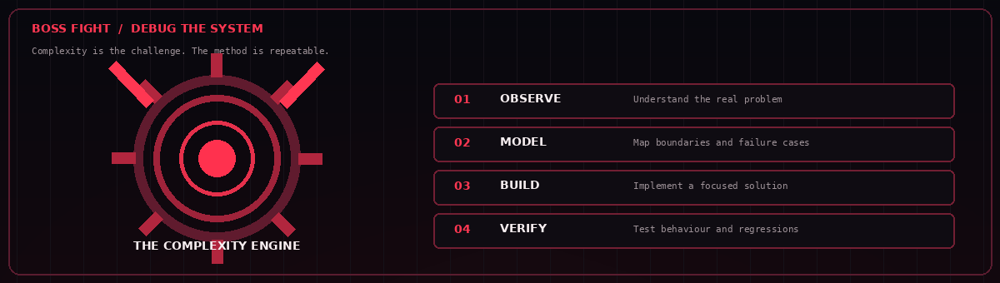

**The boss is complexity—not a fictional enemy.** My approach:

1. **Observe:** reproduce the problem and understand the actual requirement.
2. **Model:** map dependencies, system boundaries and failure cases.
3. **Build:** implement the smallest maintainable solution.
4. **Verify:** test behaviour, inspect edge cases and check regressions.

## 06 / AUTOMOTIVE GARAGE

A parametric piston–connecting rod–crankshaft mesh study connected to my Automobile Engineering background. This is a rendered learning visualisation, not a production engine model or editable CAD assembly.

## 07 / CHARACTER FILE

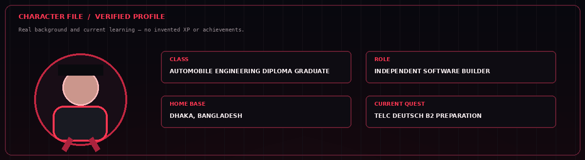

## 08 / SAVE POINT

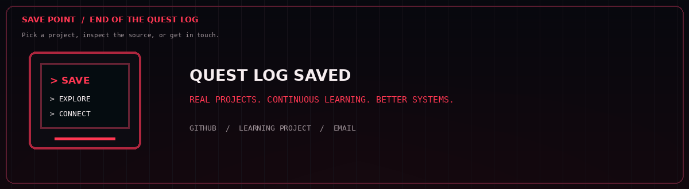

  <a href="https://github.com/shovo127">GITHUB / REPOSITORIES</a> ·
  <a href="https://lernedeutschmittechnologie.tech">LEARNING PROJECT</a> ·
  <a href="mailto:contact@lernedeutschmittechnologie.tech">EMAIL</a>

Every mission links to a real repository. Artwork is original portfolio illustration; implementation details and project status belong to the linked source.

