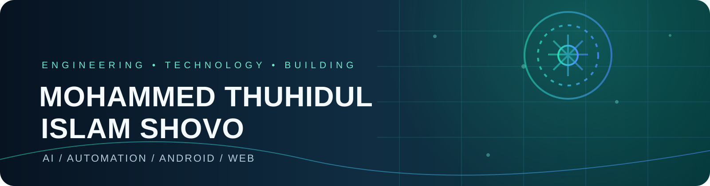
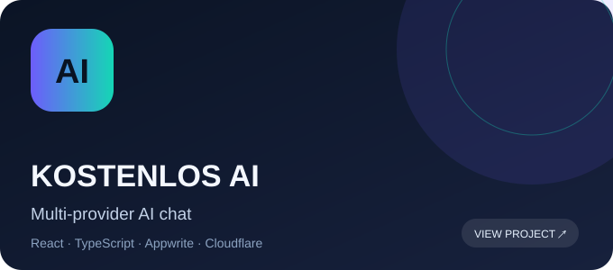
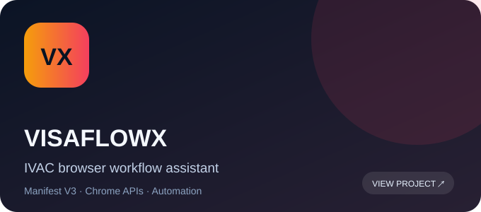
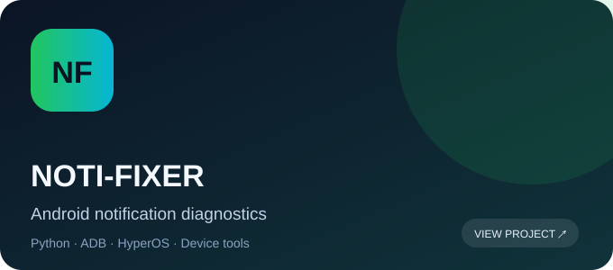
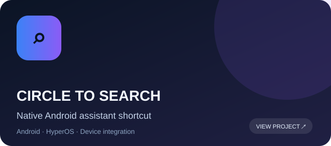

  
  
  
  

### Hello, I'm Shovo.

**Technology enthusiast · Automobile diploma engineer · Independent software builder**

I build practical digital products across **AI-powered applications, browser automation, Android utilities, and web technology**. My approach is simple: understand a real problem, design a useful solution, and improve it through careful engineering.

[Explore my projects](https://github.com/shovo127?tab=repositories) · [Visit my learning platform](https://lernedeutschmittechnologie.qzz.io/) · [MailMerge by Shovo](https://mailmergebyshovo.qzz.io/) · [Connect on GitHub](https://github.com/shovo127)

---

## About Me

  
  <h3>Mohammed Thuhidul Islam Shovo</h3>
  
<b>Automobile Engineering Graduate · IT Support · Technology & AI</b>

  

    
    
    
  

I’m a technology-focused engineer from **Dhaka, Bangladesh**, with a Diploma in Automobile Engineering. I build practical tools at the intersection of **software, automation, AI, Android, and engineering**.

- 🎓 Diploma in Engineering — Automobile, Dhaka Polytechnic Institute
- 🇩🇪 Learning German and preparing for TELC Deutsch B2
- 🧠 Exploring AI applications, web technologies, device systems, and developer tooling
- 🛠️ Interested in reliable software that solves real everyday problems

## 02 / Engineering Focus

<table>
<tr>
<td width="50%" valign="top">

### ◈ AI Applications
Multi-provider AI experiences, API integrations, user-managed credentials, intelligent chat workflows, and useful AI-powered tools.

**Featured:** [Kostenlos AI](https://github.com/shovo127/kostenlos-ai)

</td>
<td width="50%" valign="top">

### ◈ Automation Engineering
Browser extensions, configurable workflows, schedulers, monitoring, retry engines, error recovery, and desktop notifications.

**Featured:** [VisaFlowX](https://github.com/shovo127/visaflowx) · [Universal](https://github.com/shovo127/visaflowx-universal)

</td>
</tr>
<tr>
<td width="50%" valign="top">

### ◈ Android & Device Utilities
Android tooling, HyperOS-specific utilities, device compatibility, diagnostics, and notification reliability.

**Featured:** [Noti-Fixer](https://github.com/shovo127/Noti-Fixer-for-Chinese-Devices)

</td>
<td width="50%" valign="top">

### ◈ Web & Education Technology
Learning platforms, multilingual experiences, interactive practice, digital tools, and user-focused web applications.

**Featured:** [Lerne Deutsch Mit Technologie](https://lernedeutschmittechnologie.tech)

</td>
</tr>
</table>

## 03 / Featured Work

### More of my work

| Project | Focus |
|---|---|
| [Lerne Deutsch Mit Technologie](https://lernedeutschmittechnologie.tech) | German-learning platform, language practice and exam preparation |
| [MailMerge by Shovo](https://mailmergebyshovo.qzz.io/) | Email productivity and automation |
| [Smart Scanner Pro](https://github.com/shovo127/Smart-Scanner-Pro) | Utility project |
| [All repositories](https://github.com/shovo127?tab=repositories) | Browse every public project |

## 04 / Technology & Tools

**Web & Programming**
 

**Platforms & Infrastructure**
 

**Creative & Productivity**
 

These icons represent technologies and tools I work with or explore; they are not proficiency ratings.

## 05 / GitHub Command Center

## 06 / Achievements

## 07 / Your Contribution City

The 3D image will appear here after the first successful workflow run.

## 08 / Contribution Snake Game

The animated snake will appear here after the first successful workflow run.

## 09 / Coding Habits

WakaTime's report appears once a WakaTime account is connected and the repository has a valid `WAKATIME_API_KEY` secret. No coding hours are fabricated.

## 10 / Recent Writing

<!-- BLOG-POST-LIST:START -->
*Blog feed will appear here after a public RSS or Atom feed is configured.*
<!-- BLOG-POST-LIST:END -->

## 11 / Beyond Code

- **Automotive engineering:** Interested in the connection between mechanical systems, electronics, and software.
- **Language learning:** German language learning and building tools that make structured learning more accessible.
- **Technology exploration:** AI products, Android customization, PC hardware, and practical automation.

## 12 / Let's Connect

  
  

  
  

**Have an interesting technical idea or a useful project? Let's connect.**

---

*Build with curiosity. Engineer with care. Improve through iteration.*

Designed by Shovo · Dhaka, Bangladesh · Automated with GitHub Actions

