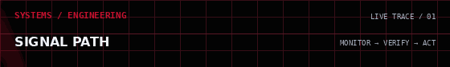
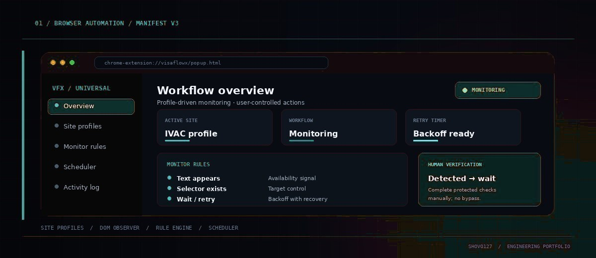
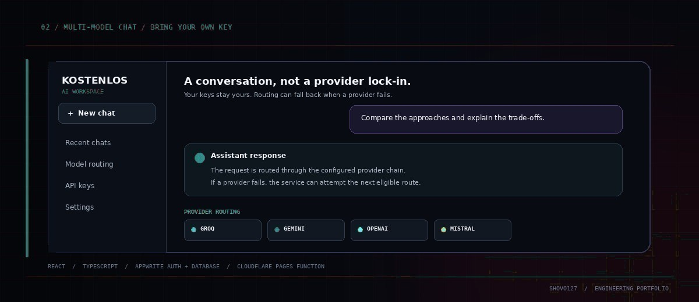
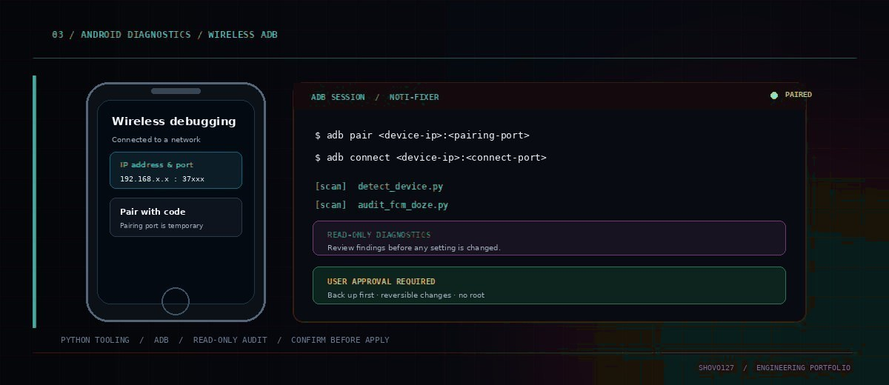
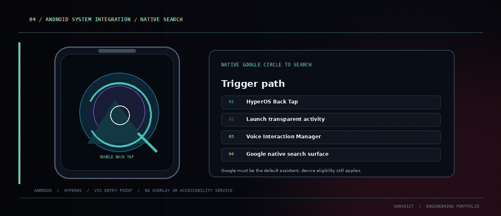
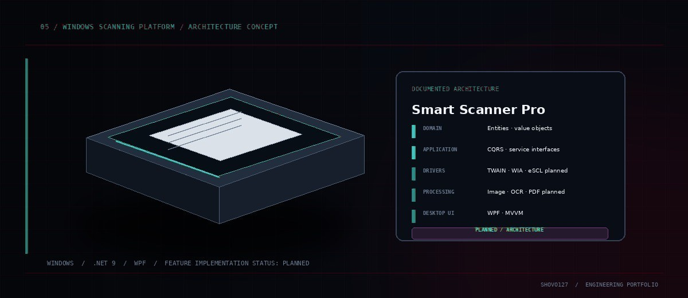
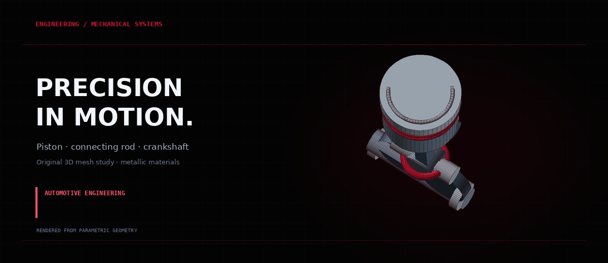
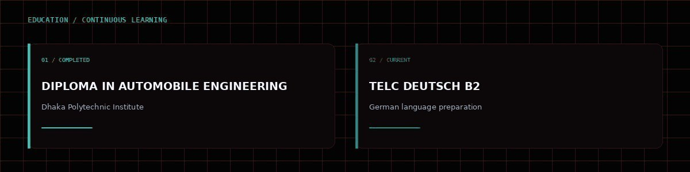
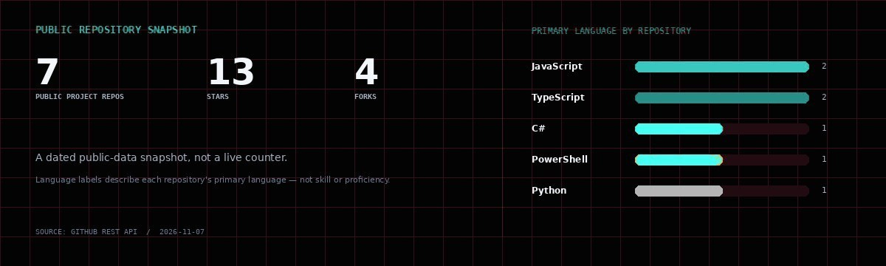

<h1 align="center">Mohammed Thuhidul Islam Shovo</h1>

<strong>Engineering Mindset · Software Building · AI & Automation · Practical Technology</strong>

Dhaka, Bangladesh · <a href="https://github.com/shovo127">GitHub</a> · <a href="https://lernedeutschmittechnologie.tech">Lerne Deutsch Mit Technologie</a>

---

## ENGINEERING PROFILE

Diploma graduate in **Automobile Engineering** from Dhaka Polytechnic Institute, building practical software around real workflows and system behaviour. My work spans browser automation, AI integrations, Android diagnostics and engineering-oriented software architecture.

I approach projects with an engineering mindset: understand the system, define its safety boundaries, build the smallest useful solution, and verify what it actually does. Current learning focus: **TELC Deutsch B2**.

## SELECTED PROJECTS

Five public projects across automation, AI, Android and desktop engineering. Each image is an original interface study based on that project's public README and source, not a screenshot of a running application.

<table>
  <tr>
    <td width="50%" valign="top" align="left">
      
      
<strong>01 / BROWSER AUTOMATION</strong>

      <h3><a href="https://github.com/shovo127/visaflowx-universal">VisaFlowX Universal</a></h3>
      
Manifest V3 workflow assistant with site profiles, DOM monitoring, configurable rules, retries, recovery, scheduling and notifications. Protected verification is handed back for the user to complete; no CAPTCHA or anti-bot bypass.

      
<strong>STACK</strong> · JavaScript · Chrome Extension APIs · Manifest V3 · MutationObserver

      
<a href="https://github.com/shovo127/visaflowx-universal">VIEW REPOSITORY ↗</a>

    </td>
    <td width="50%" valign="top" align="left">
      
      
<strong>02 / MULTI-MODEL AI</strong>

      <h3><a href="https://github.com/shovo127/kostenlos-ai">Kostenlos AI</a></h3>
      
Bring-your-own-key AI chat app. Appwrite stores user-managed provider keys; the chat function can fail over across Groq, Gemini, OpenAI and Mistral, with optional Tavily search context.

      
<strong>STACK</strong> · React · TypeScript · Tailwind CSS · Appwrite · Cloudflare Pages Functions

      
<a href="https://github.com/shovo127/kostenlos-ai">VIEW REPOSITORY ↗</a>

    </td>
  </tr>
  <tr>
    <td width="50%" valign="top" align="left">
      
      
<strong>03 / ANDROID DIAGNOSTICS</strong>

      <h3><a href="https://github.com/shovo127/Noti-Fixer-for-Chinese-Devices">Noti-Fixer for Chinese Devices</a></h3>
      
Python and ADB toolkit for wireless pairing, notification/background diagnostics and reversible settings changes on selected Android ROMs. Findings are reviewed before any changes; root is not required.

      
<strong>STACK</strong> · Python · Android Debug Bridge · Shell / PowerShell · Android

      
<a href="https://github.com/shovo127/Noti-Fixer-for-Chinese-Devices">VIEW REPOSITORY ↗</a>

    </td>
    <td width="50%" valign="top" align="left">
      
      
<strong>04 / ANDROID INTEGRATION</strong>

      <h3><a href="https://github.com/shovo127/Circle-to-Search-for-Xiaomi">Circle to Search for Xiaomi</a></h3>
      
Minimal Android trigger for Google's native Circle to Search on supported Xiaomi/HyperOS configurations. HyperOS Back Tap launches a transparent activity and invokes Android's Voice Interaction Manager. Google default-assistant and device-eligibility requirements still apply.

      
<strong>STACK</strong> · Kotlin · Android SDK · HyperOS Back Tap · Voice Interaction Manager

      
<a href="https://github.com/shovo127/Circle-to-Search-for-Xiaomi">VIEW REPOSITORY ↗</a>

    </td>
  </tr>
  <tr>
    <td width="50%" valign="top" align="left">
      
      
<strong>05 / WINDOWS ARCHITECTURE</strong>

      <h3><a href="https://github.com/shovo127/Smart-Scanner-Pro">Smart Scanner Pro</a></h3>
      
Architecture-first Windows scanning project organised around Clean Architecture and domain/application boundaries. TWAIN/WIA/eSCL drivers, OCR, image processing, PDF workflows and plugins are documented as planned features, not shipped functionality.

      
<strong>STACK</strong> · C# · .NET 9 · WPF · Clean Architecture

      
<a href="https://github.com/shovo127/Smart-Scanner-Pro">VIEW REPOSITORY ↗</a>

    </td>
    <td width="50%" valign="top" align="left">
      
<strong>OPEN-SOURCE MAINTENANCE</strong>

      <h3><a href="https://github.com/shovo127/IPTV-By-Shovo">IPTV By Shovo</a></h3>
      
Separate public collection of publicly available IPTV channel links and M3U/M3U8 playlists for compatible media players. Stream availability and legality depend on the original source and local rules.

      
<strong>FORMAT</strong> · M3U · M3U8 · Public playlist data

      
<a href="https://github.com/shovo127/IPTV-By-Shovo">VIEW REPOSITORY ↗</a>

    </td>
  </tr>
</table>

---

## TECHNICAL FOCUS

<table>
  <tr>
    <td width="33%" valign="top">
      
<strong>01 / SOFTWARE</strong>

      <h3>Software Engineering</h3>
      
Web applications, browser extensions, structured interfaces and practical system architecture.

    </td>
    <td width="33%" valign="top">
      
<strong>02 / INTELLIGENCE</strong>

      <h3>AI & Automation</h3>
      
Provider routing, API integrations, workflow rules, retries and user-controlled automation.

    </td>
    <td width="33%" valign="top">
      
<strong>03 / MOBILE</strong>

      <h3>Android Systems</h3>
      
ADB workflows, HyperOS behaviour, notification delivery diagnostics and native integrations.

    </td>
  </tr>
  <tr>
    <td width="33%" valign="top">
      
<strong>04 / MECHANICAL</strong>

      <h3>Automotive Engineering</h3>
      
Mechanical assemblies, automotive systems and diagnostic thinking grounded in diploma study.

    </td>
    <td width="33%" valign="top">
      
<strong>05 / LANGUAGE + TECH</strong>

      <h3>Learning Technology</h3>
      
Multilingual learning experiences and German study resources, with current TELC B2 preparation.

    </td>
    <td width="33%" valign="top">
      
<strong>ENGINEERING STUDY</strong>

      <h3>Mechanical Visualisation</h3>
      
CAD-inspired assembly thinking and technical visualisation alongside software work.

    </td>
  </tr>
</table>

### Automotive engineering / 3D study

Original parametric mesh study; not a representation of a specific production engine.

---

## EDUCATION & LEARNING

<table>
  <tr>
    <td width="50%" valign="top">
      
<strong>01 / COMPLETED EDUCATION</strong>

      <h3>Diploma in Automobile Engineering</h3>
      
<strong>Dhaka Polytechnic Institute</strong>

      
Technical foundation in automobile engineering.

    </td>
    <td width="50%" valign="top">
      
<strong>02 / CURRENT LEARNING</strong>

      <h3>TELC Deutsch B2</h3>
      
<strong>German language preparation</strong>

      
Currently preparing for the TELC B2 examination.

    </td>
  </tr>
</table>

---

## PUBLIC REPOSITORY SIGNAL

<table>
  <tr>
    <td width="100%" valign="top">
      
<strong>GITHUB DATA / SNAPSHOT 2026-11-07</strong>

      
      
Seven public project repositories · 13 stars · 4 forks. Primary-language labels count repositories, not code-byte share or personal proficiency. Excludes this profile repository and private repositories. Snapshot is static, not a live counter.

    </td>
  </tr>
</table>

---

## CONNECT

<table>
  <tr>
    <td width="33%" valign="top" align="center">
      
<strong>CODE / REPOSITORIES</strong>

      <h3><a href="https://github.com/shovo127">GitHub</a></h3>
      
<a href="https://github.com/shovo127">github.com/shovo127</a>

    </td>
    <td width="33%" valign="top" align="center">
      
<strong>LEARNING / EDUCATION</strong>

      <h3><a href="https://lernedeutschmittechnologie.tech">Learning Project</a></h3>
      
<a href="https://lernedeutschmittechnologie.tech">lernedeutschmittechnologie.tech</a>

    </td>
    <td width="33%" valign="top" align="center">
      
<strong>DIRECT CONTACT</strong>

      <h3><a href="mailto:contact@lernedeutschmittechnologie.tech">Email</a></h3>
      
<a href="mailto:contact@lernedeutschmittechnologie.tech">contact@lernedeutschmittechnologie.tech</a>

    </td>
  </tr>
</table>

ENGINEERING · SOFTWARE · SYSTEMS

Designed and maintained independently · Dhaka, Bangladesh

