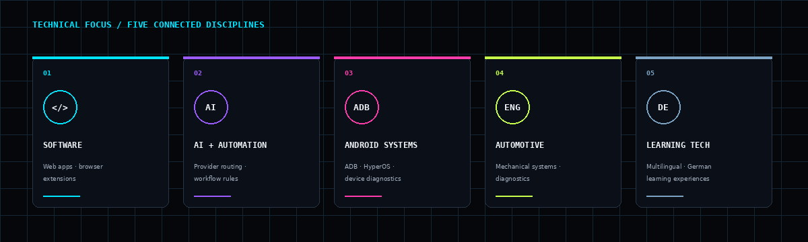

<h1 align="center">Mohammed Thuhidul Islam Shovo</h1>

<strong>Engineering Mindset · Software Building · AI & Automation · Practical Technology</strong>

Dhaka, Bangladesh · <a href="https://github.com/shovo127">GitHub</a> · <a href="https://lernedeutschmittechnologie.tech">Lerne Deutsch Mit Technologie</a>

---

## ENGINEERING PROFILE

Diploma graduate in **Automobile Engineering** from Dhaka Polytechnic Institute, building practical software around real workflows and system behaviour. My work spans browser automation, AI integrations, Android diagnostics and engineering-oriented software architecture.

I approach projects with an engineering mindset: understand the system, define its safety boundaries, build the smallest useful solution, and verify what it actually does. Current learning focus: **TELC Deutsch B2**.

## SELECTED PROJECTS

Five public projects across automation, AI, Android and desktop engineering. The visuals below are original interface studies based on each project's public README and source; they are not claimed to be screenshots of running applications.

<table>
  <tr>
    <td width="50%" valign="top">
      
      <h3>01 / <a href="https://github.com/shovo127/visaflowx-universal">VisaFlowX Universal</a></h3>
      
A Manifest V3 browser workflow assistant with site profiles, MutationObserver-based monitoring, configurable rules, retry and recovery handling, scheduling and notifications. Protected verification is detected and handed back to the user; the extension does not solve or bypass CAPTCHA or anti-bot checks.

      
<strong>STACK</strong> · JavaScript · Chrome Extension APIs · Manifest V3 · MutationObserver

      
<a href="https://github.com/shovo127/visaflowx-universal">Repository ↗</a>

    </td>
    <td width="50%" valign="top">
      
      <h3>02 / <a href="https://github.com/shovo127/kostenlos-ai">Kostenlos AI</a></h3>
      
A bring-your-own-key multi-AI chat application. Users manage their own provider keys through Appwrite; the chat function supports failover across Groq, Gemini, OpenAI and Mistral, with optional Tavily search context.

      
<strong>STACK</strong> · React · TypeScript · Tailwind CSS · Appwrite · Cloudflare Pages Functions

      
<a href="https://github.com/shovo127/kostenlos-ai">Repository ↗</a>

    </td>
  </tr>
  <tr>
    <td width="50%" valign="top">
      
      <h3>03 / <a href="https://github.com/shovo127/Noti-Fixer-for-Chinese-Devices">Noti-Fixer for Chinese Devices</a></h3>
      
A Python and ADB toolkit for wireless device pairing, notification and background-behaviour diagnostics, and user-approved reversible settings changes on selected Android ROMs. Its safety flow requires reviewing findings before applying changes; root access is not required.

      
<strong>STACK</strong> · Python · Android Debug Bridge · Shell / PowerShell · Android

      
<a href="https://github.com/shovo127/Noti-Fixer-for-Chinese-Devices">Repository ↗</a>

    </td>
    <td width="50%" valign="top">
      
      <h3>04 / <a href="https://github.com/shovo127/Circle-to-Search-for-Xiaomi">Circle to Search for Xiaomi</a></h3>
      
A minimal native Android trigger for Google's Circle to Search on supported Xiaomi and HyperOS configurations. A HyperOS Double Back Tap launches a transparent activity that invokes Android's Voice Interaction Manager route. Google must be the default assistant, and Google's device eligibility still applies.

      
<strong>STACK</strong> · Kotlin · Android SDK · HyperOS Back Tap · Voice Interaction Manager

      
<a href="https://github.com/shovo127/Circle-to-Search-for-Xiaomi">Repository ↗</a>

    </td>
  </tr>
  <tr>
    <td colspan="2" valign="top">
      
      <h3>05 / <a href="https://github.com/shovo127/Smart-Scanner-Pro">Smart Scanner Pro</a></h3>
      
An architecture-first Windows document-scanning project organised around Clean Architecture and domain/application boundaries. TWAIN, WIA and eSCL drivers, OCR, image processing, PDF workflows and plugin features are explicitly marked as planned in the project README; this portfolio does not present them as shipped functionality.

      
<strong>STACK</strong> · C# · .NET 9 · WPF · Clean Architecture

      
<a href="https://github.com/shovo127/Smart-Scanner-Pro">Repository ↗</a>

    </td>
  </tr>
</table>

---

## TECHNICAL FOCUS

My interests connect software systems with practical engineering: web applications and extensions, provider integrations and rule engines, Android device diagnostics, mechanical systems, and multilingual learning tools.

### Automotive engineering / 3D study

Original parametric 3D mesh study rendered from source geometry. It is an engineering visual, not a claim about a specific production engine.

---

## EDUCATION & LEARNING

- **Completed:** Diploma in Automobile Engineering — Dhaka Polytechnic Institute.
- **Current learning:** German language, preparing for TELC Deutsch B2.

---

## PUBLIC REPOSITORY SIGNAL

Snapshot date: 7 November 2026. Counts cover seven public project repositories and exclude this profile repository and private repositories. Language bars count each repository's GitHub-reported primary language; they do not represent code-byte share or personal proficiency. Contribution history remains available in GitHub's native contribution graph.

---

## CONNECT

- **GitHub:** [github.com/shovo127](https://github.com/shovo127)
- **Learning project:** [Lerne Deutsch Mit Technologie](https://lernedeutschmittechnologie.tech)

ENGINEERING · SOFTWARE · SYSTEMS

Designed and maintained independently · Dhaka, Bangladesh

