

### Mohammed Thuhidul Islam Shovo
**Automobile Engineering Graduate · Independent Software Builder · Technology Enthusiast**

*I turn curiosity into practical tools — combining engineering thinking with software, automation and AI.*

[Projects](https://github.com/shovo127?tab=repositories) · [Lerne Deutsch Mit Technologie](https://lernedeutschmittechnologie.tech) · [MailMerge by Shovo](https://mailmergebyshovo.qzz.io/) · [GitHub](https://github.com/shovo127)

---

## 01 / About Me

<table>
<tr>
<td width="52%" valign="middle">
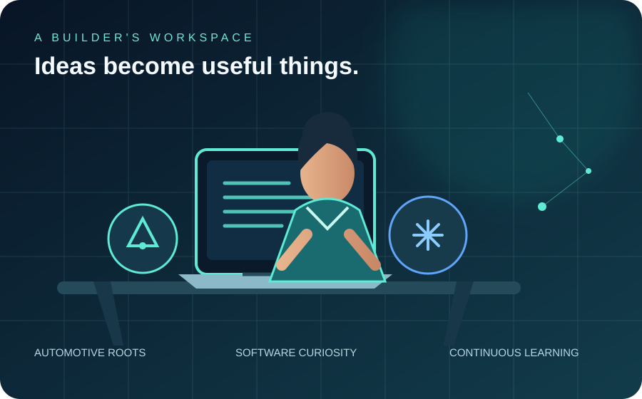
</td>
<td width="48%" valign="middle">
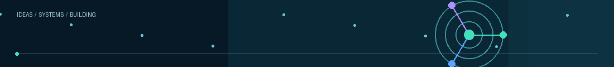

### Engineer by training. Builder by curiosity.

I’m based in **Dhaka, Bangladesh**, with a Diploma in Automobile Engineering from **Dhaka Polytechnic Institute**. My interests connect mechanical systems, software, digital products and practical problem-solving.

- 🎓 Diploma in Engineering — Automobile
- 🇩🇪 Learning German; preparing for TELC Deutsch B2
- 🧩 Building AI-powered tools and browser automation
- 📱 Exploring Android, HyperOS and device reliability
- 🌱 Learning by building, testing and improving

**My principle:** make technology useful, understandable and accessible.
</td>
</tr>
</table>

## 02 / Engineering Focus

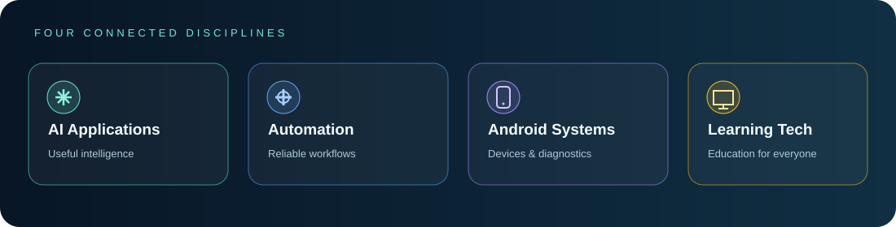

I work across connected disciplines rather than treating technology as isolated tools:

- **AI applications** — useful AI experiences, API integrations and multi-provider workflows.
- **Automation engineering** — browser workflows, scheduling, monitoring, retries and error recovery.
- **Android systems** — device tooling, HyperOS utilities, diagnostics and notification reliability.
- **Learning technology** — multilingual learning, interactive practice and exam preparation.

## 03 / Featured Work

### More projects

| Project | What it explores |
|---|---|
| [Lerne Deutsch Mit Technologie](https://lernedeutschmittechnologie.tech) | German learning, language practice and exam preparation |
| [MailMerge by Shovo](https://mailmergebyshovo.qzz.io/) | Email productivity and automation |
| [Smart Scanner Pro](https://github.com/shovo127/Smart-Scanner-Pro) | Utility application |
| [All repositories](https://github.com/shovo127?tab=repositories) | Explore public source code |

## 04 / Technology & Tools

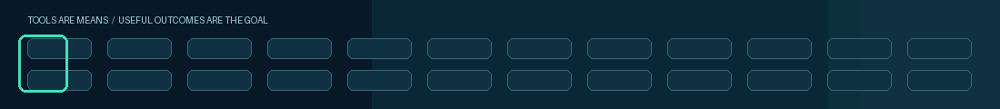

These are technologies I work with or explore — not claims of equal proficiency.

## 05 / GitHub Command Center

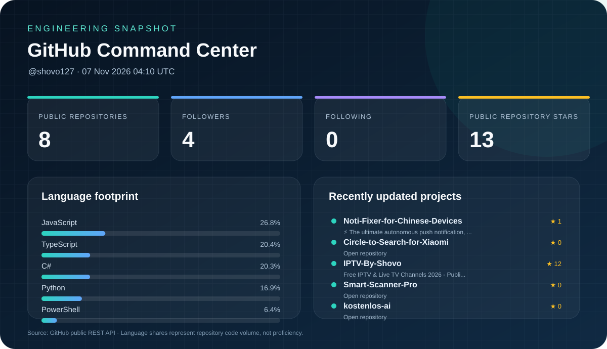

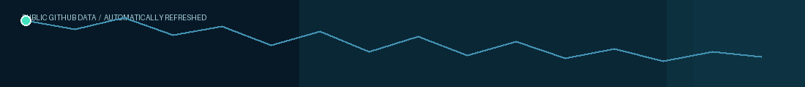

Generated from GitHub's public API and committed to this repository. Language shares indicate code volume, not skill level. Dashboard refreshes automatically.

[Dashboard workflow](https://github.com/shovo127/shovo127/actions/workflows/profile-dashboard.yml) · [Public repositories](https://github.com/shovo127?tab=repositories)

## 06 / Achievements & Milestones

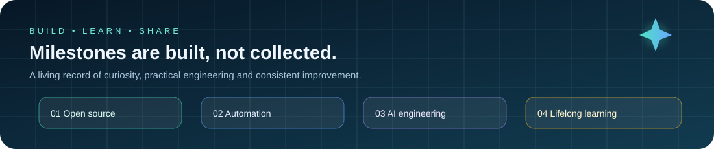

*Milestones are evidence of work and learning — not a substitute for building useful things.*

## 07 / Your Contribution City

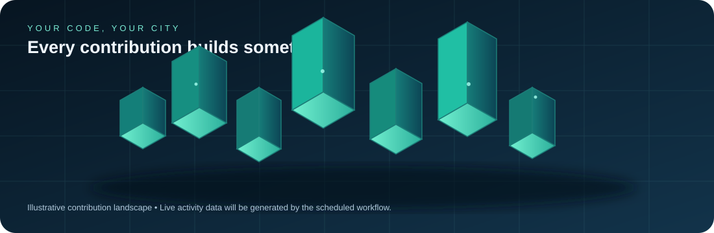

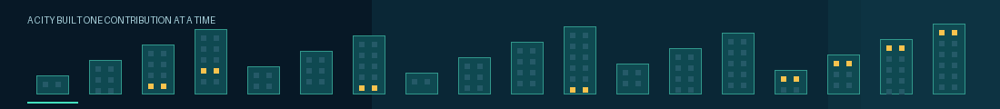

*Every meaningful contribution adds another piece to the city.*

## 08 / Contribution Snake

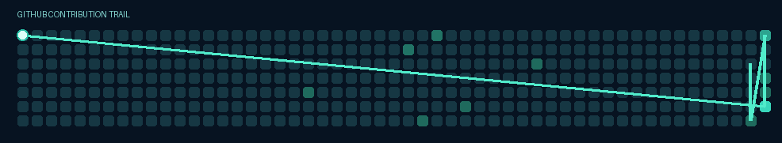

Generated from the public contribution calendar when GitHub makes the data available. A local visual fallback is retained if the API is unavailable.

## 09 / Coding Habits

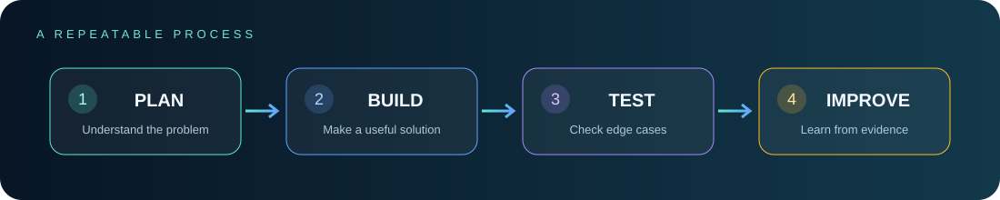

I prefer sustainable progress: plan clearly, build in small steps, test carefully and improve based on evidence. No coding-hour totals or productivity scores are invented.

## 10 / Learning Loop

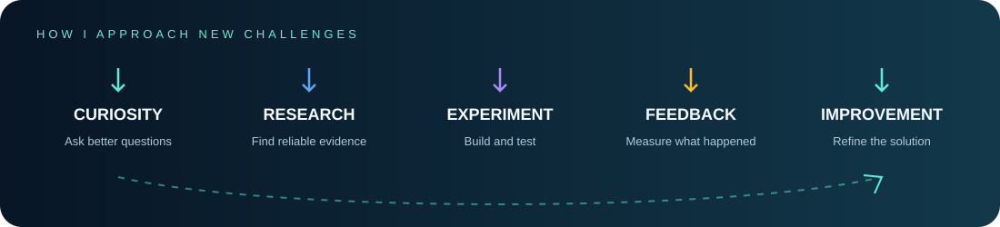

*Curiosity → Research → Experiment → Feedback → Improvement.*

## 11 / Beyond Code

- **Automotive engineering:** connecting mechanical systems, electronics and software.
- **Language learning:** German and tools that make structured learning more accessible.
- **Technology exploration:** AI products, Android customization, PC hardware and practical automation.

## 12 / Let's Connect

<a href="https://github.com/shovo127">GitHub · @shovo127</a> · <a href="https://discord.com/users/838358451393396746">Discord</a> · <a href="https://discord.gg/kcAhn7n3kb">Community</a>

<a href="https://lernedeutschmittechnologie.tech">Lerne Deutsch Mit Technologie</a> · <a href="https://mailmergebyshovo.qzz.io/">MailMerge by Shovo</a> · <a href="https://www.instagram.com/thuhidul_islamshovo/">Instagram</a>

**Have an interesting technical idea or a useful project? Let's connect.**

---

*Build with curiosity. Engineer with care. Improve through iteration.*

Designed and illustrated for Shovo · Dhaka, Bangladesh · Core profile media stored in this repository

