

<h1 align="center">Mohammed Thuhidul Islam Shovo</h1>

<strong>Engineering Mindset · Software Building · AI & Automation · Practical Technology</strong>

Dhaka, Bangladesh · <a href="https://github.com/shovo127">GitHub</a> · <a href="https://lernedeutschmittechnologie.tech">Lerne Deutsch Mit Technologie</a>

---

## ENGINEERING PROFILE

Diploma graduate in **Automobile Engineering** from Dhaka Polytechnic Institute, building practical software around real workflows and system behaviour. My work spans browser automation, multi-provider AI, Android diagnostics, desktop architecture and learning technology.

I approach engineering by understanding the system, defining safety boundaries, building useful tools and verifying actual behaviour. Current learning focus: **TELC Deutsch B2**.

## SELECTED PROJECTS

Six project studies. The animated artwork is a rendered visual interpretation of each repository's documented workflow, not a screenshot of a live application.

<table>
  <tr>
    <td width="50%" valign="top">
      <a href="https://github.com/shovo127/visaflowx-universal">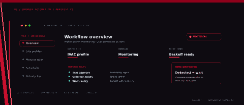</a>
      
<strong>01 / BROWSER AUTOMATION · MANIFEST V3</strong>

      <h3><a href="https://github.com/shovo127/visaflowx-universal">VisaFlowX Universal</a></h3>
      
Profile-driven browser workflow assistant with DOM monitoring, configurable rules, retries, scheduling and notifications. Protected verification is handed back to the user; no CAPTCHA or anti-bot bypass.

      
<strong>STACK</strong> · JavaScript · Chrome Extension APIs · MutationObserver

      
<a href="https://github.com/shovo127/visaflowx-universal">VIEW REPOSITORY ↗</a>

    </td>
    <td width="50%" valign="top">
      <a href="https://github.com/shovo127/kostenlos-ai">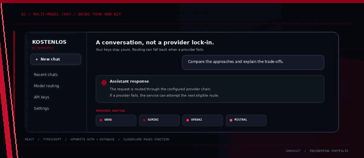</a>
      
<strong>02 / MULTI-PROVIDER AI</strong>

      <h3><a href="https://github.com/shovo127/kostenlos-ai">Kostenlos AI</a></h3>
      
Bring-your-own-key AI chat application. Appwrite stores user-managed provider keys; the chat function supports failover across Groq, Gemini, OpenAI and Mistral, with optional Tavily search context.

      
<strong>STACK</strong> · React · TypeScript · Appwrite · Cloudflare Pages Functions

      
<a href="https://github.com/shovo127/kostenlos-ai">VIEW REPOSITORY ↗</a>

    </td>
  </tr>
  <tr>
    <td width="50%" valign="top">
      <a href="https://github.com/shovo127/Noti-Fixer-for-Chinese-Devices">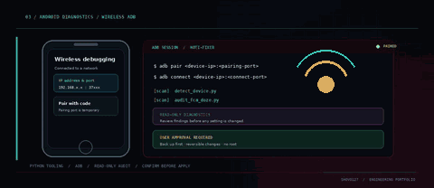</a>
      
<strong>03 / ANDROID DIAGNOSTICS</strong>

      <h3><a href="https://github.com/shovo127/Noti-Fixer-for-Chinese-Devices">Noti-Fixer for Chinese Devices</a></h3>
      
Python and ADB toolkit for wireless pairing, notification/background diagnostics and reversible settings on selected Android ROMs. Findings are reviewed and changes require user approval.

      
<strong>STACK</strong> · Python · ADB · Shell / PowerShell · Android

      
<a href="https://github.com/shovo127/Noti-Fixer-for-Chinese-Devices">VIEW REPOSITORY ↗</a>

    </td>
    <td width="50%" valign="top">
      <a href="https://github.com/shovo127/Circle-to-Search-for-Xiaomi">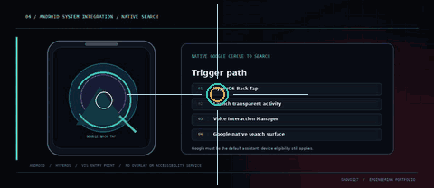</a>
      
<strong>04 / ANDROID INTEGRATION</strong>

      <h3><a href="https://github.com/shovo127/Circle-to-Search-for-Xiaomi">Circle to Search for Xiaomi</a></h3>
      
Minimal Android trigger for Google's native Circle to Search on supported Xiaomi/HyperOS configurations. A transparent activity invokes Android's Voice Interaction Manager. Google default-assistant and device-eligibility requirements apply.

      
<strong>STACK</strong> · Kotlin · Android SDK · HyperOS Back Tap · Voice Interaction Manager

      
<a href="https://github.com/shovo127/Circle-to-Search-for-Xiaomi">VIEW REPOSITORY ↗</a>

    </td>
  </tr>
  <tr>
    <td width="50%" valign="top">
      <a href="https://github.com/shovo127/Smart-Scanner-Pro">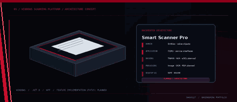</a>
      
<strong>05 / WINDOWS ARCHITECTURE</strong>

      <h3><a href="https://github.com/shovo127/Smart-Scanner-Pro">Smart Scanner Pro</a></h3>
      
Windows scanning architecture organised around C#/.NET and Clean Architecture boundaries. TWAIN/WIA/eSCL integration, OCR, image processing, PDF workflows and plugins are treated as planned scope unless implemented in the repository.

      
<strong>STACK</strong> · C# · .NET · WPF · Clean Architecture

      
<a href="https://github.com/shovo127/Smart-Scanner-Pro">VIEW REPOSITORY ↗</a>

    </td>
    <td width="50%" valign="top">
      <a href="https://github.com/shovo127/IPTV-By-Shovo">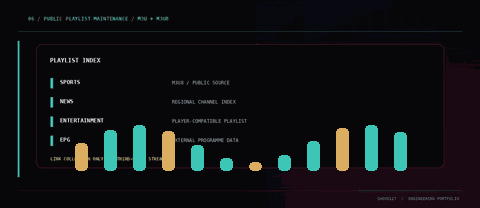</a>
      
<strong>06 / OPEN PLAYLIST MAINTENANCE</strong>

      <h3><a href="https://github.com/shovo127/IPTV-By-Shovo">IPTV By Shovo</a></h3>
      
Public collection of third-party channel links and M3U/M3U8 playlists for compatible media players. No video streams are hosted by this repository; source availability and rights remain with original providers.

      
<strong>FORMAT</strong> · M3U · M3U8 · Playlist data

      
<a href="https://github.com/shovo127/IPTV-By-Shovo">VIEW REPOSITORY ↗</a>

    </td>
  </tr>
</table>

## TECHNICAL FOCUS

Six distinct engineering disciplines, presented as separate visual cards.

<table>
  <tr>
    <td width="50%" valign="top">
      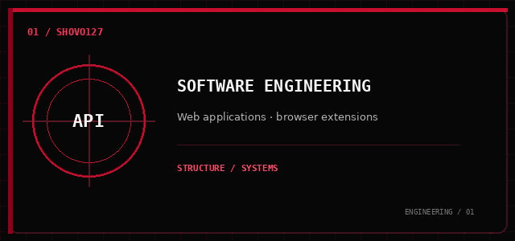
      <h3>01 — Software Engineering</h3>
      
Web applications, browser extensions, structured interfaces and practical architecture.

    </td>
    <td width="50%" valign="top">
      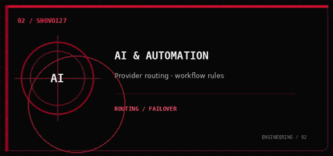
      <h3>02 — AI & Automation</h3>
      
Multi-provider integrations, routing, retries and user-controlled workflows.

    </td>
  </tr>
  <tr>
    <td width="50%" valign="top">
      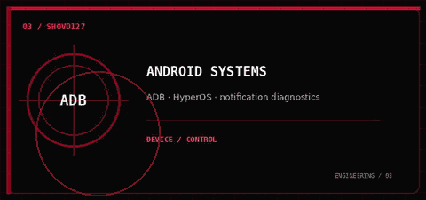
      <h3>03 — Android Systems</h3>
      
ADB workflows, HyperOS behaviour, notification diagnostics and native integrations.

    </td>
    <td width="50%" valign="top">
      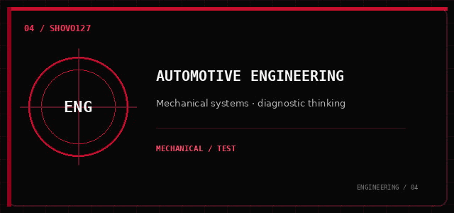
      <h3>04 — Automotive Engineering</h3>
      
Mechanical assemblies, automotive systems and diagnostic thinking grounded in diploma study.

    </td>
  </tr>
  <tr>
    <td width="50%" valign="top">
      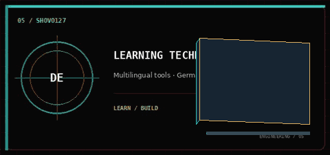
      <h3>05 — Learning Technology</h3>
      
Multilingual learning experiences and German study resources, including current TELC B2 preparation.

    </td>
    <td width="50%" valign="top">
      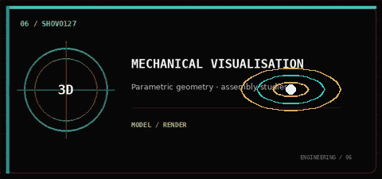
      <h3>06 — Mechanical Visualisation</h3>
      
Parametric geometry, assembly studies and technical visualisation alongside software work.

    </td>
  </tr>
</table>

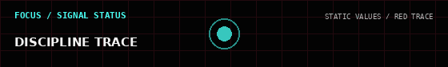

## AUTOMOTIVE ENGINEERING / 3D STUDY

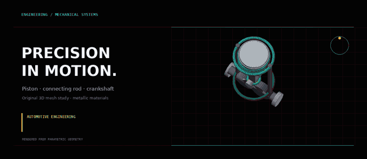

Original parametric mesh study rendered from generated geometry; not a production engine model. The available source is a rendered study, not an editable CAD assembly.

## EDUCATION & LEARNING

<table>
  <tr>
    <td width="50%" valign="top">
      
<strong>01 / COMPLETED</strong>

      <h3>Diploma in Automobile Engineering</h3>
      
<strong>Dhaka Polytechnic Institute</strong>

      
Technical education in automobile engineering.

    </td>
    <td width="50%" valign="top">
      
<strong>02 / CURRENT LEARNING</strong>

      <h3>TELC Deutsch B2</h3>
      
<strong>German language preparation</strong>

      
Currently preparing for the TELC B2 examination.

    </td>
  </tr>
</table>

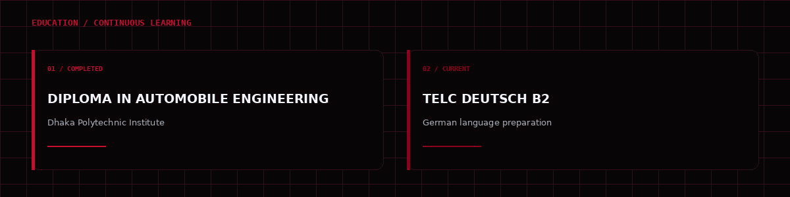

## PUBLIC REPOSITORY ANALYTICS

<table>
  <tr>
    <td width="100%" valign="top">
      
<strong>GITHUB PUBLIC DATA / SNAPSHOT 2026-11-07</strong>

      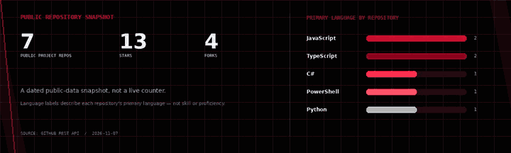
      
Seven public project repositories · 13 stars · 4 forks. Language counts represent each repository's primary language, not code-byte share or personal proficiency. The snapshot excludes this profile repository and private repositories. Values are static, not live.

    </td>
  </tr>
</table>

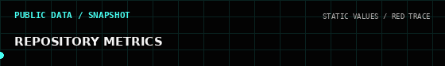

---

## CONNECT

<table>
  <tr>
    <td width="33%" valign="top" align="center">
      
<strong>CODE / REPOSITORIES</strong>

      <h3><a href="https://github.com/shovo127">GitHub</a></h3>
      
<a href="https://github.com/shovo127">github.com/shovo127</a>

    </td>
    <td width="33%" valign="top" align="center">
      
<strong>LEARNING / EDUCATION</strong>

      <h3><a href="https://lernedeutschmittechnologie.tech">Learning Project</a></h3>
      
<a href="https://lernedeutschmittechnologie.tech">lernedeutschmittechnologie.tech</a>

    </td>
    <td width="33%" valign="top" align="center">
      
<strong>DIRECT CONTACT</strong>

      <h3><a href="mailto:contact@lernedeutschmittechnologie.tech">Email</a></h3>
      
<a href="mailto:contact@lernedeutschmittechnologie.tech">contact@lernedeutschmittechnologie.tech</a>

    </td>
  </tr>
</table>

<table>
  <tr>
    <td width="50%" valign="top" align="center">
      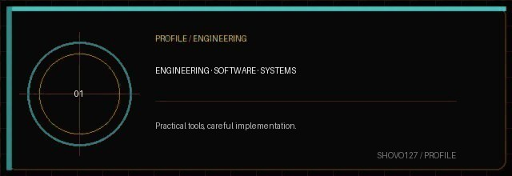
      
<strong>ENGINEERING · SOFTWARE · SYSTEMS</strong>

      
Practical tools, careful implementation.

    </td>
    <td width="50%" valign="top" align="center">
      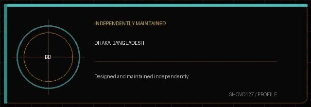
      
<strong>DHAKA, BANGLADESH</strong>

      
Designed and maintained independently.

    </td>
  </tr>
</table>
